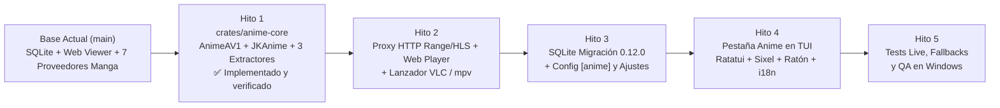
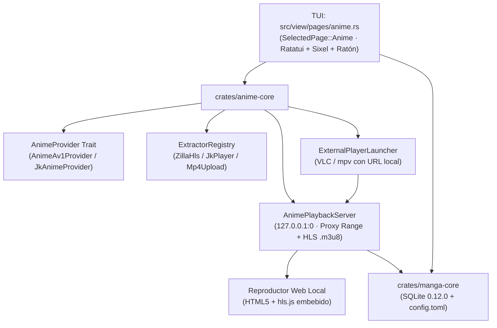

# Roadmap de Anime v1 (`manga-tui` · Rama `Anime`)

Este documento define el diseño técnico, la arquitectura y los criterios de aceptación para integrar la pestaña **`Anime`** nativa en **`manga-tui`**, empezando por los proveedores en español **AnimeAV1** (`https://animeav1.com`) y **JKAnime** (`https://jkanime.net`), con **Reproductor Web local** por defecto (`127.0.0.1`) y soporte opcional para **VLC / mpv** desde Ajustes.

> [!IMPORTANT]
> **Decisión de arquitectura:** En lugar de envolver scripts externos como `ani-cli-mx` (que dependen de `bash`, `fzf`, `python3`, `yt-dlp`, `sed`/`grep`/`gawk` y tienen licencia GPLv3), implementamos el motor completo de forma **100 % nativa y clean-room en Rust** bajo la licencia **MIT** del proyecto, reutilizando el mismo patrón de servidor local que ya usa [`web_viewer.rs`](crates/manga-core/src/backend/web_viewer.rs).

---

## 1. Visión, alcance v1 y fronteras

### Objetivo de la v1
Convertir `manga-tui` en una experiencia unificada de **Manga + Anime** sin romper ninguna de las ventajas actuales del proyecto:

- **Binario único autocontenido en Windows/Linux/macOS:** cero dependencias obligatorias de terminal/Python/shell para el usuario final (instalador `.exe` y modo portable intactos).
- **Reproductor Web local por defecto (`http://127.0.0.1:<puerto>/`):** interfaz oscura limpia sin anuncios, popups ni rastreadores, con soporte HLS (`.m3u8`), selector de servidores/mirrors, cambio de episodio anterior/siguiente y guardado automático de progreso.
- **VLC / mpv opcional:** configurable en Ajustes (`<c>` / `config.toml`), apuntando al proxy HTTP local de Rust para que VLC/mpv no fallen por cabeceras `Referer`/`User-Agent` ni por segmentos HLS disfrazados.
- **Historial local en SQLite:** guardado de animes vistos, favoritos y posición exacta de reproducción (`progress_seconds`) + marcado automático al completar (`>= 85 %`).

### Fronteras de alcance (qué queda fuera de v1)

| Área | Incluido en v1 | Reservado para v1.1+ |
| :--- | :--- | :--- |
| **Proveedores** | **AnimeAV1** + **JKAnime** | AnimeFLV, TioAnime, PelisPlusHD |
| **Extractores de vídeo** | **ZillaHLS** (`player.zilla-networks.com`), **JKPlayer** (`Magi` / `Desu` / `Desuka`), **MP4Upload** | VOE, Streamwish, Vidhide, Filemoon, YourUpload, Pixeldrain |
| **Reproducción** | Reproductor Web local (`hls.js` + `<video>`) + lanzador **VLC / mpv** | Cola "Reproducir siguiente automático" en segundo plano |
| **Persistencia** | SQLite local (`animes`, `anime_episodes`, migración `0.12.0`) + `[anime]` en `config.toml` | Google Drive Sync (`library_sync.json`) y tracking automático en AniList / MyAnimeList |
| **Descargas** | Streaming directo sin descargas | Descarga offline `.mp4` / `.mkv` en cola |
| **Apps derivadas** | TUI (`manga-tui`) + crate compartido `crates/anime-core` | Integración en interfaz gráfica `apps/mangora` |

---

## 2. Mapa de Hitos



| Hito | Objetivo principal | Entregables clave |
| :--- | :--- | :--- |
| **Hito 1 · Motor `anime-core`** ✅ | Crate aislado con catálogo y extractores | `crates/anime-core`, traits `AnimeProvider` y `VideoExtractor`, `AnimeAv1Provider` (decodificador SvelteKit `devalue`), `JkAnimeProvider` (HTML + AJAX con cookie jar/CSRF), `ZillaHlsExtractor`, `JkPlayerExtractor`, `Mp4UploadExtractor`, tests con `httpmock` y tests live (`--ignored`) |
| **Hito 2 · Streaming y Reproductores** | Proxy local real y reproducción sin anuncios | `AnimePlaybackServer` (`127.0.0.1:0`, chunks `bytes_stream`, `Range`/`206`, reescritura `.m3u8` + `#EXT-X-MAP`), Web Player HTML5 + `hls.js` embebido, `ExternalPlayerLauncher` (VLC/mpv auto-detectado) |
| **Hito 3 · Persistencia y Config** | Historial local y preferencias | Tablas `animes` y `anime_episodes`, migración idempotente `0.12.0` en `migration.rs`, actualización de `database.rs` y `database_scheme.md`, bloque `[anime]` en `config.toml` y `SettingsModal` |
| **Hito 4 · Pestaña `Anime` en TUI** | Interfaz completa en Ratatui | `SelectedPage::Anime`, `src/view/pages/anime.rs`, buscador, portadas Sixel/Kitty (margen inferior 1 fila), ficha/episodios con progreso, selector de mirror, `ThemePalette`, `tr(es, en)` y hitboxes de ratón |
| **Hito 5 · Pulido y QA Windows** | Estabilidad y verificación final | Tests live `#[ignore]`, fallback automático entre mirrors/proveedores, actualización de `README.md`, `cargo fmt`, `clippy`, `cargo test` y pruebas en Windows Terminal / portable / instalador |

---

## 3. Hallazgos técnicos verificados en vivo (2026-11-24)

Las siguientes rutas, estructuras y cabeceras fueron verificadas directamente contra los servidores en producción el **2026-11-24**. Ambos sitios responden con **HTTP 200 OK** usando un `User-Agent` de navegador estándar **sin bloqueo por Cloudflare JS Challenge**.

| Proveedor | Stack técnico | Búsqueda | Listado de episodios | Mirrors principales | Estado HTTP |
| :--- | :--- | :--- | :--- | :--- | :--- |
| **AnimeAV1** (`animeav1.com`) | SvelteKit SSR + `/__data.json` (`devalue`) | JSON nativo (`?search=...`) | Todos en la ficha (1 petición) | `HLS` (`zilla-networks`), `MP4Upload`, `Voe`, `UPNShare`, `Byse` | `200 OK` |
| **JKAnime** (`jkanime.net`) | Laravel/Blade SSR + AJAX CSRF | HTML SSR (`/buscar/<q>/<p>/`) | `POST /ajax/episodes/<id>/<p>` (16/pág.) | `Magi` (`umv`), `Desu` (`um`), `Desuka`, `Mp4upload`, `VOE`, `Streamwish`, `Filemoon` | `200 OK` |

---

### 3.1 AnimeAV1 (`https://animeav1.com`)

AnimeAV1 está construido con SvelteKit y expone endpoints `__data.json` oficiales de hidratación. No hace falta parsear HTML para catálogo, ficha ni episodios: basta decodificar el array de referencias planas (*devalue hydration format*) dentro de `nodes[2].data`.

1. **Búsqueda y catálogo**
   - Endpoint: `GET https://animeav1.com/catalogo/__data.json?search=<query>&page=<page>`
   - Datos devueltos:
     - `results[]`: `{ id, title, synopsis, categoryId, slug, category }`
     - `pagination`: `{ currentPage, recordsPerPage, totalPages, totalRecords }`
   - URL de portada: `https://cdn.animeav1.com/covers/<id>.jpg`
2. **Detalle y listado completo de episodios (en 1 sola petición)**
   - Endpoint: `GET https://animeav1.com/media/<slug>/__data.json`
   - Datos devueltos en `media`: `id`, `title`, `synopsis`, `genres[]`, `score`, `malId`, `episodesCount`, `status`, `slug`, `category`, y `episodes: [{ id, number }]`.
3. **Mirrors de un episodio**
   - Endpoint: `GET https://animeav1.com/media/<slug>/<number>/__data.json`
   - Datos devueltos:
     - `embeds`: mapa por variante (`SUB`, y opcionalmente `DUB`) con objetos `{ server, url }`. En pruebas reales sobre *One Piece Ep. 1* devuelve: `HLS`, `UPNShare`, `Voe`, `Byse`, `MP4Upload`.
     - `downloads`: enlaces alternativos (`Mega`, `1Fichier`, `MP4Upload`).
4. **Extractor principal `ZillaHlsExtractor` (`server == "HLS"`)**
   - URL del embed: `https://player.zilla-networks.com/play/<hash_32_hex>`
   - El script del reproductor construye directamente la playlist HLS:
     `https://player.zilla-networks.com/m3u8/<hash_32_hex>` (responde `200 OK`, `Content-Type: application/x-mpegURL`, `#EXT-X-VERSION:7`, `#EXT-X-PLAYLIST-TYPE:VOD`).

> [!WARNING]
> **Trampa crítica verificada en `player.zilla-networks.com`:**
> La playlist usa fMP4 (HLS v7) con segmento de inicialización `#EXT-X-MAP:URI="https://player.zilla-networks.com/segs/<hash>/init.html"` y fragmentos de vídeo `.../000.html`, `.../001.html`, etc. **disfrazados con extensión `.html`**.
> El proxy local en Rust **DEBE**:
> 1. Reescribir tanto las líneas de segmento como los atributos `URI="..."` dentro de `#EXT-X-MAP` y `#EXT-X-KEY`.
> 2. Normalizar el `Content-Type` al entregar esos fragmentos al cliente (por ejemplo `video/mp4` o `application/octet-stream`) para evitar bloqueos de MIME estricto o fallos de *seek* en `hls.js` y VLC.

---

### 3.2 JKAnime (`https://jkanime.net`)

JKAnime usa HTML clásico renderizado en servidor (Laravel) combinado con un endpoint AJAX protegido por sesión y token CSRF.

1. **Búsqueda**
   - Endpoint: `GET https://jkanime.net/buscar/<query_con_guiones_bajos>/<page>/` (los espacios se reemplazan por `_`).
   - Selectores CSS verificados:
     - Tarjeta: `.row.page_directorio > div[data-g]` (el atributo `data-g` contiene el `anime_id` numérico codificado en Base64, ej. `MjAx` → `201`).
     - Título y enlace/slug: `.anime__item h5 a[href]`
     - Portada: `.anime__item__pic[data-setbg]` (ej. `https://cdn.jkdesa.com/assets/images/animes/image/one-piece.jpg`)
     - Estado y tipo: `.anime__item__text ul li`
2. **Ficha del anime y token de sesión**
   - Endpoint: `GET https://jkanime.net/<slug>/`
   - Selectores CSS verificados:
     - Título: `div.anime_info h3`
     - Sinopsis: `div.anime_info p.scroll`
     - Portada: `div.anime_pic img[src]`
     - Metadatos (tipo, géneros, estudios, episodios, estado, puntuación): `div.anime_data ul li`
     - ID numérico: `#guardar-anime[data-anime]`
     - Último episodio disponible: `#uep[href]`
     - Token CSRF obligatorio: `meta[name="csrf-token"]` (`content`)
3. **Listado paginado de episodios (16 episodios por página)**
   - Endpoint: `POST https://jkanime.net/ajax/episodes/<anime_id>/<page>`
   - Cabeceras / cuerpo: formulario `_token=<csrf_token>` enviando las cookies de sesión (`XSRF-TOKEN` + `jkanime-session`) con `reqwest::ClientBuilder::cookie_store(true)`.
   - Soporta episodios decimales/huecos y debe incluir pausa o *backoff* exponencial si el servidor devuelve `HTTP 429`.
4. **Mirrors de un episodio (`GET https://jkanime.net/<slug>/<episode>/`)**
   - **Players nativos (`var video = [...]` + botones `.bg-servers a`):**
     - **`Magi` (`https://jkanime.net/jkplayer/umv?...`)**: devuelve HTML limpio con un `<source src="https://nika.playmudos.com/...m3u8?st=...&e=..." type="application/x-mpegURL">` directo. Sin ofuscación.
     - **`Desu` (`https://jkanime.net/jkplayer/um?...`)**: embebe DPlayer con la URL `.m3u8` codificada en Base64 (`atob('...')`) y también en claro dentro de `hls.loadSource('...m3u8?st=...&e=...')`. Sin ofuscación.
     - **`Desuka` (`https://jkanime.net/jkplayer/jk?u=stream/jkmedia/...`)**: disponible como respaldo secundario.
   - **Mirrors externos (`var servers = [...]` JSON inline):**
     - Array JSON con objetos `{ remote: "<url_en_base64>", slug, server, lang, size }` incluyendo `Mp4upload`, `Streamwish`, `Vidhide`, `VOE`, `Filemoon`, `Mixdrop`, `Streamtape`, `Doodstream`, `Mega`, `Mediafire`.

---

### 3.3 Extractor compartido de respaldo: `Mp4UploadExtractor`

Presente en **ambos** proveedores (`MP4Upload` en AnimeAV1, `Mp4upload` en JKAnime):

- Petición: `GET https://www.mp4upload.com/embed-<id>.html` enviando `Referer` del proveedor correspondiente.
- Extracción: HTML directo sin ofuscación que contiene `player.src({ type: "video/mp4", src: "https://<host>/d/<token>/video.mp4" })`, extraíble mediante expresión regular.
- Reproducción: el proxy HTTP local reenvía la petición MP4 inyectando `Referer: https://www.mp4upload.com/` y soportando cabeceras `Range` (`206 Partial Content`) para adelantar/retroceder al instante.

---

## 4. Arquitectura propuesta

### Separación de módulos en el workspace

Para evitar sobrecargar [`src/view/app.rs`](src/view/app.rs) (~3.100 líneas) y no acoplar la lógica de vídeo a dependencias pesadas de manga (`lopdf`, `epub-builder`), todo el backend de anime vive en un crate dedicado: **`crates/anime-core`**, registrado en el `[workspace]` raíz de [`Cargo.toml`](Cargo.toml).



### Estructura de `crates/anime-core`

```text
crates/anime-core/
├── Cargo.toml
└── src/
    ├── lib.rs
    ├── model.rs              # AnimeProviders, AnimeSummary, AnimeDetails, Episode, Mirror, ResolvedStream
    ├── provider.rs           # Trait AnimeProvider
    ├── provider/
    │   ├── animeav1.rs       # Cliente SvelteKit /__data.json + parser devalue
    │   └── jkanime.rs        # Cliente Laravel HTML/AJAX + cookies + CSRF
    ├── extractor.rs          # Trait VideoExtractor + ExtractorRegistry + fallback automático
    ├── extractor/
    │   ├── zilla_hls.rs      # player.zilla-networks.com/play/<hash> -> /m3u8/<hash>
    │   ├── jkplayer.rs       # jkplayer/umv (Magi) + jkplayer/um (Desu)
    │   └── mp4upload.rs      # mp4upload.com/embed-<id>.html -> MP4 directo
    ├── player/
    │   ├── external.rs       # Auto-detección y lanzamiento de VLC / mpv
    │   └── web_player.html   # UI oscura sin anuncios + hls.js embebido
    └── playback_server.rs    # Servidor HTTP 127.0.0.1:0 (streaming Range + reescritura m3u8)
```

### Traits y contratos principales (diseño en Rust)

```rust
#[derive(Debug, Clone, Copy, PartialEq, Eq, Hash, Serialize, Deserialize)]
pub enum AnimeProviders {
    AnimeAv1,
    JkAnime,
}

#[derive(Debug, Clone, Copy, PartialEq, Eq, Serialize, Deserialize)]
pub enum AnimeVariant {
    Sub,
    Dub,
}

#[derive(Debug, Clone, Copy, PartialEq, Eq, Serialize, Deserialize)]
pub enum StreamKind {
    Hls,
    Mp4,
}

pub struct ResolvedStream {
    pub stream_url: String,
    pub headers: Vec<(String, String)>, // Referer, Origin, User-Agent necesarios
    pub kind: StreamKind,
    pub server_name: String,
    pub quality: Option<String>,
}

pub trait AnimeProvider: Send + Sync {
    fn kind(&self) -> AnimeProviders;
    async fn search(&self, query: &str, page: u32) -> Result<AnimeSearchResult, AnimeError>;
    async fn get_details(&self, slug: &str) -> Result<AnimeDetails, AnimeError>;
    async fn get_episodes(&self, details: &AnimeDetails, page: u32) -> Result<AnimeEpisodesPage, AnimeError>;
    async fn get_episode_mirrors(&self, slug: &str, episode_number: &str) -> Result<Vec<VideoMirror>, AnimeError>;
}

pub trait VideoExtractor: Send + Sync {
    fn name(&self) -> &'static str;
    fn can_handle(&self, embed_url: &str, server_hint: &str) -> bool;
    async fn extract(&self, client: &reqwest::Client, mirror: &VideoMirror) -> Result<ResolvedStream, AnimeError>;
}
```

- **Orden de prioridad en `ExtractorRegistry`:**
  1. `ZillaHlsExtractor` (`HLS` / `player.zilla-networks.com`)
  2. `JkPlayerExtractor` (`Magi` / `Desu` / `Desuka`)
  3. `Mp4UploadExtractor` (`MP4Upload`)
- Si el mirror elegido por el usuario (o el preferido por defecto) falla al extraer o responde con error HTTP, el orquestador intenta automáticamente el siguiente extractor compatible y registra qué mirror acabó funcionando.

---

## 5. Diseño del Proxy Local, Reproductor Web y VLC/mpv

### 5.1 `AnimePlaybackServer` (Proxy HTTP dedicado en `127.0.0.1`)

A diferencia de [`web_viewer.rs`](crates/manga-core/src/backend/web_viewer.rs) (optimizado para páginas de cómic pequeñas en memoria), el servidor de anime debe manejar archivos MP4 de cientos de MB y flujos HLS segmentados sin consumir RAM innecesaria:

- **Dirección y ciclo de vida:** `TcpListener::bind("127.0.0.1:0")` bajo demanda al reproducir el primer episodio (una sola instancia compartida por sesión, puerto efímero).
- **Streaming real por chunks:** uso de `reqwest::Response::bytes_stream()` reenviado directamente al `TcpStream` sin almacenar el vídeo completo en memoria.
- **Soporte HTTP `Range` (`206 Partial Content`):** reenvía la cabecera entrante `Range` al servidor remoto y devuelve `206 Partial Content`, `Content-Range`, `Accept-Ranges: bytes` y `Content-Length` para que tanto `<video>` como VLC/mpv puedan saltar a cualquier minuto al instante.
- **Reescritura `.m3u8`:**
  - Convierte todas las URLs absolutas o relativas de sub-playlists y segmentos a `/proxy/<token>/seg?u=<base64url>`.
  - Reescribe también los atributos `URI="..."` dentro de `#EXT-X-MAP` y `#EXT-X-KEY` (imprescindible para `ZillaHLS`).
  - Si un segmento termina en `.html` pero proviene de una playlist HLS (caso `player.zilla-networks.com`), fuerza `Content-Type: video/mp4` (o `application/octet-stream`).
- **Protección anti-SSRF:** cada sesión genera un `<token>` aleatorio por arranque; el endpoint `/proxy/<token>/seg` **solo** permite descargar URLs cuyo host/ruta pertenezcan al `ResolvedStream` activo o hayan sido emitidos por la playlist `.m3u8` verificada de esa sesión.

#### Rutas del servidor local
- `GET /watch/<token>` — HTML del Reproductor Web.
- `GET /assets/<token>/hls.min.js` — Copia embebida (`include_str!`) de `hls.js` para funcionar sin depender de CDNs externos ni bloqueadores de anuncios.
- `GET /stream/<token>/master.m3u8` — Playlist HLS reescrita apuntando al proxy local.
- `GET /stream/<token>/video.mp4` — Proxy directo MP4 con soporte `Range` e inyección de `Referer`.
- `GET /proxy/<token>/seg?u=<b64url>` — Proxy de segmentos HLS / sub-playlists / llaves con cabeceras originales.
- `GET /api/<token>/state` — JSON con título, portada, lista de episodios, episodio actual, mirrors disponibles, progreso guardado y estado de reproducción.
- `POST /api/<token>/episode` — Cambia al episodio seleccionado (anterior/siguiente/lista) y actualiza el stream activo.
- `POST /api/<token>/mirror` — Cambia a otro servidor de vídeo si el actual falla o va lento.
- `POST /api/<token>/progress` — Recibe `{ episode_number, position_seconds, duration_seconds }` cada ~10 s, guarda posición en SQLite y marca `is_watched = 1` al alcanzar `auto_mark_watched_percent`.

### 5.2 Reproductor Web Local (modo por defecto)

- Estética oscura limpia inspirada en los temas de `manga-tui`, **cero anuncios y cero scripts de terceros**.
- Controles integrados:
  - Episodio anterior / siguiente + selector rápido de episodio.
  - Selector de mirror/servidor en pantalla con fallback automático si `hls.js` o `<video>` dispara error fatal de red/medio.
  - Selector de variante (`SUB` / `DUB` cuando el proveedor tenga ambas).
  - Botón **Saltar intro (`+85s`)** y reanudación automática en `progress_seconds` (si hay progreso previo).
  - Atajos de teclado: `Espacio`/`k` (pausa), `f` (pantalla completa), `m` (silenciar), `←`/`→` (`-5s`/`+5s`), `n`/`p` (siguiente/anterior episodio), `s` (`+85s`).

### 5.3 Reproductor Externo (`VLC` / `mpv` · opcional en Ajustes)

- **Detección automática en Windows / Linux / macOS:**
  - `VLC`: `custom_player_path` → `PATH` (`vlc.exe` / `vlc`) → `C:\Program Files\VideoLAN\VLC\vlc.exe` → `C:\Program Files (x86)\VideoLAN\VLC\vlc.exe`.
  - `mpv`: `custom_player_path` → `PATH` (`mpv.exe` / `mpv`) → rutas comunes en Windows.
- **Lanzamiento desacoplado (`std::process::Command::spawn`):**
  - Apunta siempre a `http://127.0.0.1:<port>/stream/<token>/master.m3u8` (o `/video.mp4`), **nunca** a la URL remota cruda. Así el proxy local se encarga de `Referer`, `User-Agent` y segmentos `.html` de forma transparente tanto en VLC como en mpv.
  - Pasa título legible del episodio (`--meta-title="<Anime> - Ep. <N>"` en VLC; `--force-media-title="<Anime> - Ep. <N>"` en mpv).
  - Si el binario no se encuentra, muestra un modal claro con la ruta esperada o sugiere volver al **Reproductor Web**.

---

## 6. Persistencia SQLite (Migración `0.12.0`) y Configuración

### 6.1 Base de datos SQLite (`crates/manga-core`)

Siguiendo las reglas de [`db-migration-helper`](.agents/skills/db-migration-helper/SKILL.md):
1. Añadir `migrate_version_0_12_0` en `crates/manga-core/src/backend/migration.rs` (siguiendo a la `0.11.0` actual) y registrarla en `update_database_with_migrations`.
2. Añadir las tablas e índices en `Database::setup()` (`crates/manga-core/src/backend/database.rs`) para instalaciones limpias.
3. Documentar las nuevas tablas en `crates/manga-core/src/backend/database_scheme.md`.
4. Escribir tests unitarios de migración idempotente (`PRAGMA table_info` / `sqlite_master` + segunda ejecución `Ok(None)`).

```sql
CREATE TABLE IF NOT EXISTS animes (
    id              INTEGER PRIMARY KEY AUTOINCREMENT,
    provider        TEXT NOT NULL,
    slug            TEXT NOT NULL,
    title           TEXT NOT NULL,
    cover_url       TEXT NULL,
    status          TEXT NULL,
    is_favorite     BOOLEAN NOT NULL DEFAULT 0,
    created_at      DATETIME NOT NULL DEFAULT (datetime('now')),
    last_watched_at DATETIME NULL,
    UNIQUE (provider, slug)
);

CREATE TABLE IF NOT EXISTS anime_episodes (
    id               INTEGER PRIMARY KEY AUTOINCREMENT,
    anime_id         INTEGER NOT NULL,
    episode_number   TEXT NOT NULL,
    episode_slug     TEXT NOT NULL,
    is_watched       BOOLEAN NOT NULL DEFAULT 0,
    progress_seconds INTEGER NOT NULL DEFAULT 0,
    duration_seconds INTEGER NOT NULL DEFAULT 0,
    last_watched_at  DATETIME NULL,
    FOREIGN KEY (anime_id) REFERENCES animes (id) ON DELETE CASCADE,
    UNIQUE (anime_id, episode_number)
);

CREATE INDEX IF NOT EXISTS idx_animes_provider_last_watched
    ON animes (provider, last_watched_at DESC);

CREATE INDEX IF NOT EXISTS idx_anime_episodes_anime_number
    ON anime_episodes (anime_id, episode_number);
```

> [!NOTE]
> `episode_number` se almacena como `TEXT` para soportar sin errores episodios especiales o decimales habituales en catálogos de anime (ej. `"12.5"`, `"0"`, `"1015"`).

### 6.2 Configuración (`config.toml` y `SettingsModal`)

Añadir sección `[anime]` con `#[serde(default)]` en [`config.rs`](crates/manga-core/src/config.rs) para mantener retrocompatibilidad total con archivos `config.toml` existentes:

```toml
# Anime streaming & playback settings
[anime]
# Preferred anime provider
# values: animeav1, jkanime
# default: "animeav1"
preferred_provider = "animeav1"

# Playback target when opening an episode
# values: web, vlc, mpv
# default: "web"
player = "web"

# Optional custom path to VLC or mpv executable (leave empty for auto-detection)
# default: ""
custom_player_path = ""

# Preferred audio/subtitle variant when available
# values: sub, dub
# default: "sub"
preferred_variant = "sub"

# Progress percentage threshold to mark an episode as watched automatically
# values: 50..100
# default: 85
auto_mark_watched_percent = 85
```

En `SettingsModal` (`src/view/widgets/settings.rs`) se añaden los controles equivalentes:
- Proveedor de Anime por defecto (`AnimeAV1` / `JKAnime`)
- Reproductor de Anime (`Web (Local)` / `VLC` / `mpv`)
- Variante preferida (`SUB` / `DUB`)

---

## 7. Diseño de la Pestaña `Anime` en la TUI

### Integración mínima en `App`
- Registrar `SelectedPage::Anime` en [`src/view/pages.rs`](src/view/pages.rs).
- Delegar todo el estado, tareas asíncronas, renderizado y eventos en un nuevo módulo independiente: `src/view/pages/anime.rs` (`impl Component`), manteniendo [`src/view/app.rs`](src/view/app.rs) limpio.
- Respetar las reglas de [`ratatui-widget-creator`](.agents/skills/ratatui-widget-creator/SKILL.md):
  - Usar siempre tokens semánticos de `crate::theme::palette()` (`src/theme.rs`).
  - Localizar todas las cadenas visibles con `crate::i18n::tr(es, en)`.
  - Registrar hitboxes de ratón teniendo en cuenta `scroll_offset` y los límites de área.
  - Clamping estricto de las portadas Sixel/Kitty (`height.saturating_sub(1)` en el borde inferior) para no provocar saltos del buffer de terminal.

### Boceto de layout (Ratatui)

```text
+---------------------------------------------------------------------------------------------------+
| [Inicio]  [Buscar]  [Feed]  [Noticias]  [Anime]                       Proveedor: AnimeAV1   [Web] |
+---------------------------------------------------------------------------------------------------+
| Buscar anime: [ Frieren_____________________________ ]   [Buscar]   [Hist/Fav]   [p] Cambiar prov. |
+------------------------------------------+--------------------------------------------------------+
| Resultados / Historial reciente (22)     | Ficha del Anime                                        |
| > Sousou no Frieren          [TV · 28ep] | +------------+ Sousou no Frieren            ★ Fav    |
|   Sousou no Frieren 2nd S.   [TV · ...]  | |  Portada   | Estado: Finalizado · Nota: 9.1          |
|   One Piece                  [TV · ...]  | |  Sixel/    | Géneros: Aventura, Drama, Fantasía      |
|   ...                                    | |  Kitty     | Sinopsis: Durante su búsqueda de una    |
|                                          | +------------+ década para derrotar al Rey Demonio...  |
|                                          +--------------------------------------------------------+
|                                          | Episodios (28)                    Mirrors: HLS / MP4Up |
|                                          |  ✓ Ep. 01  (Visto)                                     |
|                                          |  ▶ Ep. 02  [12:34 / 24:10]  <-- seleccionado           |
|                                          |    Ep. 03                                              |
+------------------------------------------+--------------------------------------------------------+
| [Enter] Ver (Web) · [w] Web · [v] VLC/mpv · [s] Mirror · [f] Favorito · [m] Marcar visto · [p] Prov|
+---------------------------------------------------------------------------------------------------+
```

### Atajos de teclado y flujo de usuario
- `Tab` / clic en barra superior → entrar/salir entre buscador, lista de resultados y lista de episodios.
- `Enter` sobre un resultado → carga ficha y episodios (y precarga portada).
- `Enter` sobre un episodio → resuelve el mejor mirror compatible, inicia el proxy local y abre el reproductor configurado en `[anime].player` (`Web` por defecto o `VLC`/`mpv`).
- `w` → fuerza apertura en el **Reproductor Web local** sin cambiar Ajustes.
- `v` → fuerza apertura en **VLC / mpv** sin cambiar Ajustes.
- `s` → abre popup rápido de selección de mirror (`HLS`, `Magi`, `Desu`, `MP4Upload`, etc.) antes de lanzar.
- `f` → alternar favorito en SQLite.
- `m` → marcar / desmarcar episodio como visto manualmente.
- `p` → alternar proveedor (`AnimeAV1` ↔ `JKAnime`).

---

## 8. Estrategia de pruebas y criterios de aceptación de la v1

### Pruebas automatizadas
1. **Unit tests sin red (`cargo test --workspace`):**
   - Parser `devalue` de `AnimeAV1` con fixtures reales sanitizados (búsqueda, ficha y mirrors de episodio).
   - Parser HTML/AJAX de `JKAnime` con `httpmock` simulando cookies, CSRF, paginación de 16 episodios y respuesta `429`.
   - Extractores (`ZillaHlsExtractor`, `JkPlayerExtractor`, `Mp4UploadExtractor`) con HTMLs reales guardados en `crates/anime-core/tests/fixtures/`.
   - Proxy HTTP local: reescritura de `#EXT-X-MAP:URI="..."`, normalización MIME de segmentos `.html`, cabeceras `Range` / `206 Partial Content` y bloqueo SSRF de URLs fuera de sesión.
   - Migración SQLite `0.12.0`: creación limpia, actualización desde DB `0.11.0` existente e idempotencia al ejecutarse dos veces.
   - Retrocompatibilidad de `config.toml`: cargar configuraciones antiguas sin sección `[anime]` con valores por defecto intactos.
2. **Tests de integración en vivo (`#[ignore]`):**
   - `cargo test -p anime-core -- --ignored` para validar búsqueda, ficha y extracción real contra `animeav1.com` y `jkanime.net` antes de cada release (patrón `provider-doctor`).

### Criterios de aceptación para dar por cerrada la v1
- [ ] Buscar un anime desde la pestaña `Anime` en **AnimeAV1** y **JKAnime**, ver su portada, sinopsis y lista completa de episodios.
- [ ] Reproducir un episodio en el **Reproductor Web local** sin anuncios/popups, pudiendo cambiar de episodio, cambiar de mirror y adelantar/retroceder la barra de tiempo sin errores de CORS/MIME (`hls.js` + `Range`).
- [ ] Reproducir un episodio con **VLC** (y/o **mpv**) en Windows seleccionándolo en Ajustes o pulsando `v`, pasando a través del proxy local `127.0.0.1` sin fallos de `Referer`.
- [ ] Guardar automáticamente progreso en segundos y marcar episodios como vistos al superar el umbral configurado (`85 %`), persistiendo tras cerrar y abrir `manga-tui` (tanto en modo instalado como en modo portable `data/`).
- [ ] CI en verde (`cargo fmt --all -- --check`, `cargo clippy --workspace --all-targets`, `cargo test --workspace`).
