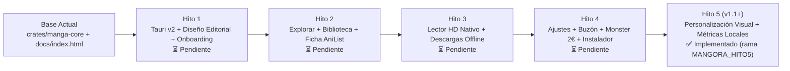

# Roadmap de Mangora · App de Escritorio (Tauri v2)

**Mangora** es la aplicación de escritorio nativa pensada para el público general (*normie*) construida sobre el motor Rust existente de `manga-tui` ([`crates/manga-core`](crates/manga-core)). Vive dentro de este mismo workspace en `apps/mangora/` usando **Tauri v2 + React + TypeScript + Vite + Tailwind CSS**, y comparte exactamente el mismo directorio de datos que `manga-tui` (`config.toml`, `history/manga-tui-history.db`, `mangaDownloads/`, `errorLogs/`) para mantener compatibilidad total entre ambas interfaces.

> [!IMPORTANT]
> **Frontera de alcance:** La **Estantería Digitalizada 3D** (con grosor dinámico en escala logarítmica y personalización de baldas/muebles) queda reservada para un **proyecto independiente 100 % legal y publicable en tiendas oficiales**. **Mangora** se centra en ofrecer una interfaz de escritorio limpia, amigable y sin terminal sobre `crates/manga-core` (con personalización visual de la UI en la v1.1+).

---

## Mapa de Hitos

| Hito | Estado | Objetivo principal |
| :--- | :--- | :--- |
| **Hito 1** | ⏳ Pendiente | Scaffold Tauri v2 en `apps/mangora/`, sistema de diseño editorial (`docs/index.html`) y Onboarding de primeros pasos |
| **Hito 2** | ⏳ Pendiente | Explorar/Buscar con portadas HD, Biblioteca compartida SQLite y Ficha de serie con reseñas de AniList y acceso a Discord |
| **Hito 3** | ⏳ Pendiente | Lector HD nativo (online + 100 % offline en CBZ/RAW/EPUB/PDF) y gestor de cola de descargas en tiempo real |
| **Hito 4** | ⏳ Pendiente | Ajustes simples (Drive/AniList/MAL), Buzón de opiniones seguro, botón *"¿Me invitas a un Monster? ⚡ 2 €"* y empaquetado Windows |
| **Hito 5 (v1.1+)** | ✅ Implementado (`MANGORA_HITO5`) | Personalización visual avanzada de temas/tarjetas y métricas locales ampliadas del lector |

---

## Sistema de Diseño Editorial (heredado de `docs/index.html`)

Toda la interfaz gráfica de **Mangora** debe seguir fielmente la estética de papel manga y tinta definida en [`docs/index.html`](docs/index.html):

### Paleta de colores

- **Modo Papel (por defecto):**
  - Fondo principal (`--paper`): `#f8f7f1`
  - Superficie secundaria / tarjetas destacadas: `#ecebe3`
  - Tinta / texto y bordes (`--ink`): `#191918`
  - Acento rojo (`--red`): `#cb3028` (hover `#a1201b`)
  - Texto secundario (`--muted`): `#55554f`
  - Líneas y divisores (`--line`): `#c8c7bc`
  - Anillo de foco accesible (`:focus-visible`): `3px solid #0077b6` (`outline-offset: 4px`)
- **Modo Tinta (oscuro opcional para lectura nocturna):**
  - Fondo principal: `#141413`
  - Superficie / tarjetas: `#1f1f1d`
  - Tinta clara / texto principal: `#f8f7f1`
  - Acento rojo adaptado sobre oscuro: `#ff8a76` / `#cb3028`
  - Líneas / bordes secundarios: `#3a3a35`

### Tipografía

- **Display / Titulares:** `"Arial Black", "Archivo Black", Arial, sans-serif` (`letter-spacing: -0.065em`, `line-height: 1.04`, peso `900`)
- **Cuerpo / UI general:** `"Segoe UI", Arial, sans-serif`
- **Metadatos, etiquetas, *eyebrows* y barras técnicas:** `"Cascadia Mono", Consolas, "Courier New", monospace`

### Lenguaje visual obligatorio

- Bordes sólidos de alto contraste (`2px solid var(--ink)` o `1px solid var(--ink)` en controles secundarios).
- Sombras duras desplazadas sin difuminado (`3px 3px var(--ink)` en botones/inputs y `6px 6px var(--ink)` en tarjetas o visor principal).
- Bloques de énfasis con barra lateral roja (`border-left: 0.4rem solid var(--red)`).
- Tramas de puntos tipo *screentone* para acentos visuales (`radial-gradient(var(--red) 1px, transparent 1.4px) 0 0 / 6px 6px`).
- Barras de herramientas del lector en tinta negra (`background: var(--ink)`) con texto claro y controles nítidos.
- **Evitar** *glassmorphism*, transparencias borrosas genéricas, degradados SaaS o bordes excesivamente redondeados que rompan la estética editorial de papel y tinta.

---

## Arquitectura y módulos de `crates/manga-core` a reutilizar

### Disposición del workspace

- [`crates/manga-core`](crates/manga-core): motor Rust compartido entre `manga-tui` y **Mangora**. Módulos clave en [`crates/manga-core/src/backend`](crates/manga-core/src/backend):
  - Catálogo y fuentes: `multi_provider`, `manga_provider`, `html_parser`, `cache`
  - Persistencia y descargas: `database`, `migration`, `download_queue`, `manga_downloader`, `offline`
  - Sincronización y trackers: `cloud`, `tracker` (AniList + MyAnimeList), `secrets`
  - Utilidades y soporte: `web_viewer`, `updater`, `release_notifier`, `error_log`, `config`, `i18n`, `runtime_settings`
- [`src/`](src): binario CLI/TUI `manga-tui` (debe permanecer 100 % operativo y sin regresiones).
- `apps/mangora/src-tauri/`: crate Rust de Tauri v2 conectado al workspace (`Cargo.toml`) que expone comandos `#[tauri::command]` y eventos en tiempo real sobre `manga-core`.
- `apps/mangora/src/`: frontend en **React + TypeScript + Vite + Tailwind CSS**.

### Almacenamiento compartido (`AppDirectories`)

Definido en [`crates/manga-core/src/backend.rs`](crates/manga-core/src/backend.rs) y [`crates/manga-core/src/config.rs`](crates/manga-core/src/config.rs), respetando la misma precedencia (`MANGA_TUI_DATA_DIR` > modo portable `data/` > directorio estándar del sistema):

- `config.toml` — preferencias y estado general
- `history/manga-tui-history.db` — biblioteca, favoritos, progreso de lectura e historial SQLite
- `mangaDownloads/` — capítulos descargados en formatos `CBZ`, `RAW`, `EPUB` y `PDF`
- `errorLogs/manga-tui-error-logs.txt` — registros de error

---

## Hito 1 · Base Tauri v2, Estética `index.html` y Onboarding de Primeros Pasos

- **Estado:** `⏳ Pendiente`

### Prompt sugerido para nuevo hilo

> Lee `MANGORA_ROADMAP.md` y `docs/index.html`. Vamos a ejecutar el **Hito 1**: crea el proyecto Tauri v2 + React + TypeScript + Vite + Tailwind CSS en `apps/mangora/` integrado con `crates/manga-core`, implementa el sistema de diseño Papel/Tinta, el shell de navegación principal y el flujo de Onboarding de primeros pasos (idioma, gustos/géneros, servidor recomendado y mini-tour).

### Alcance técnico y entregables

1. **Scaffold en el workspace (`apps/mangora/`):**
   - Configurar `apps/mangora/src-tauri/` con Tauri v2 enlazando `manga-core = { path = "../../../crates/manga-core" }` (y actualizar miembros del workspace raíz en `Cargo.toml` cuidando que `cargo check` y `cargo test` sigan funcionando en `manga-tui`).
   - Configurar `apps/mangora/` con Vite + React + TypeScript + Tailwind CSS.
2. **Design System Papel y Tinta:**
   - Variables CSS y clases base replicando la estética editorial de `docs/index.html` (Modo Papel `#f8f7f1` por defecto y toggle a Modo Tinta `#141413`), tipografía display/cuerpo/mono, sombras duras, bordes `2px` y detalles *screentone*.
   - Shell principal con navegación clara para *normies*: **Inicio / Biblioteca**, **Explorar**, **Descargas**, **Ajustes** y acceso directo a **Apoyar / Discord**.
3. **Comandos Tauri iniciales (`src-tauri`):**
   - Inicializar entorno de datos compartidos de `manga-core` sin abrir consola negra en Windows.
   - Comando para leer estado inicial: idioma, modo de almacenamiento activo, y detección automática de si ya existe biblioteca/historial previo de `manga-tui`.
   - Comandos para guardar las preferencias del Onboarding (idioma, géneros de interés, proveedor/servidor recomendado y flag de onboarding completado).
4. **Onboarding de Primeros Pasos (*User*):**
   - Paso 1: Selección de idioma (`Español` / `English`) con cambio inmediato de textos.
   - Paso 2: Selección de gustos/géneros favoritos (p. ej. *Shonen*, *Seinen*, *Romance*, *Fantasía*, *Slice of Life*, etc.) y asignación automática del proveedor/servidor recomendado acorde al idioma (con opción clara de cambiarlo luego).
   - Paso 3: Si se detectan datos previos de `manga-tui`, mostrar aviso de *"Biblioteca detectada y lista"*; si está vacía, mini-tour guiado explicando qué hace cada sección (`Explorar`, `Biblioteca`, `Descargas`, `Ajustes`).
   - Permitir volver a lanzar el tour desde Ajustes.

### Criterios de aceptación

- [ ] `apps/mangora/` compila y arranca la ventana nativa Tauri v2 en Windows sin mostrar ventana de consola extra.
- [ ] La UI aplica fielmente los tokens visuales de `docs/index.html` (Papel `#f8f7f1`, Tinta `#191918`, Rojo `#cb3028`, sombras duras y tipografía mono/display) y soporta cambio a Modo Tinta.
- [ ] El Onboarding guarda idioma, gustos y proveedor recomendado, y no vuelve a mostrarse al reiniciar una vez completado.
- [ ] `cargo check` y `cargo test` del workspace (`manga-tui` y `manga-core`) pasan sin regresiones.

---

## Hito 2 · Explorar, Biblioteca Visual y Ficha de Manga (AniList + Discord)

- **Estado:** `⏳ Pendiente`

### Prompt sugerido para nuevo hilo

> Lee `MANGORA_ROADMAP.md` y el estado actual de `apps/mangora/`. Vamos a ejecutar el **Hito 2**: conecta la pantalla Explorar/Buscar a `multi_provider`, la Biblioteca al SQLite compartido de `manga-core` y crea la Ficha de Serie con reseñas públicas de AniList y acceso a Discord.

### Alcance técnico y entregables

1. **Explorar y Buscar (`multi_provider`):**
   - Buscador rápido con portadas en HD, tarjetas editoriales con borde sólido y sombra desplazada, filtros limpios por idioma, género/etiquetas y selector simple de proveedor (mostrando el recomendado primero).
   - Bloque inicial *"Para ti según tus gustos"* usando los géneros seleccionados en el Onboarding.
   - Manejo amigable de errores si un proveedor está caído o lento (mensajes claros para *normies* con sugerencia de probar otro proveedor).
2. **Inicio / Biblioteca compartida (`database.rs`):**
   - Leer y escribir directamente sobre `history/manga-tui-history.db` manteniendo compatibilidad 100 % bidireccional con `manga-tui`.
   - Pestañas/secciones claras: **Continuar leyendo**, **Siguiendo / Favoritos** e **Historial reciente**.
   - Acciones rápidas: marcar/quitar favorito, ver último capítulo leído y abrir siguiente capítulo pendiente en 1 clic.
3. **Ficha de Serie + AniList + Discord:**
   - Vista detalle con portada grande, título, autor/estado, sinopsis, géneros y listado de capítulos ordenado con indicador claro de *Leído*, *Descargado (Offline)* y *Disponible online*.
   - **Sección de Comunidad en ficha:** consultar puntuación media, etiquetas y reseñas/comentarios públicos desde la API de **AniList** (solo lectura, sin necesidad de cuenta) + botón visible para comentar y charlar en el **Discord** oficial.

### Criterios de aceptación

- [ ] Buscar un manga devuelve portadas y resultados reales desde `multi_provider` y permite filtrar por idioma/proveedor.
- [ ] Marcar favoritos o abrir capítulos desde Mangora actualiza `history/manga-tui-history.db` y se refleja correctamente al abrir `manga-tui` (y viceversa).
- [ ] La Ficha de Serie muestra capítulos online/descargados y carga valoración/reseñas públicas de AniList de forma no bloqueante (con fallback limpio si AniList no encuentra la serie o falla la red).
- [ ] `cargo check` y `cargo test` pasan en todo el workspace.

---

## Hito 3 · Lector HD Nativo (Online + 100 % Offline) y Gestor de Descargas

- **Estado:** `⏳ Pendiente`

### Prompt sugerido para nuevo hilo

> Lee `MANGORA_ROADMAP.md` y el estado actual de `apps/mangora/`. Vamos a ejecutar el **Hito 3**: construye el Lector HD nativo dentro de Mangora (cascada, página única y doble página, online y 100 % offline con CBZ/RAW/EPUB/PDF) y la pantalla de Cola de Descargas conectada a `manga-core`.

### Alcance técnico y entregables

1. **Lector HD integrado (estilo barra de tinta de `docs/index.html`):**
   - Modos de lectura seleccionables en barra superior/inferior retráctil: **Cascada vertical (*Webtoon*)**, **Página única** y **Doble página**.
   - Dirección de lectura: **Manga (derecha → izquierda)** y **Occidental (izquierda → derecha)**.
   - Controles cómodos para *normies*: zoom / ajuste a ancho o alto, barra de progreso por página, precarga en segundo plano de las siguientes páginas y capítulos anterior/siguiente.
   - Atajos intuitivos de ratón (clic lateral / rueda) y teclado (`←`, `→`, `Espacio`, `F` pantalla completa, `Esc` volver a ficha).
   - Guardado automático de progreso (capítulo + página actual) en SQLite.
2. **Lectura 100 % Offline (`offline.rs`):**
   - Servir páginas de capítulos descargados en `mangaDownloads/` en los 4 formatos soportados (`CBZ`, `RAW`, `EPUB`, `PDF`) mediante protocolo/comando Tauri eficiente en memoria.
   - Detección automática sin conexión: si no hay internet o el capítulo ya está descargado, abrir directamente desde local mostrando el distintivo `OFFLINE / LOCAL`.
3. **Gestor y Cola de Descargas (`download_queue.rs` / `manga_downloader.rs`):**
   - Botón de descarga individual o selección múltiple de capítulos desde la ficha del manga.
   - Pantalla **Descargas** con cola activa en tiempo real (eventos Tauri de progreso, velocidad/estado, pausar/cancelar/reintentar), selector de formato (`CBZ` por defecto, `PDF`, `EPUB`, `RAW`) y botón para abrir la carpeta en el Explorador de Windows.

### Criterios de aceptación

- [ ] El lector carga capítulos online y offline con los 3 modos de vista (cascada, página única, doble página) y recuerda el modo/sentido preferido del usuario.
- [ ] Los capítulos descargados en `CBZ`, `RAW`, `EPUB` y `PDF` se leen completamente sin conexión a internet y reconcilian el estado leído en SQLite.
- [ ] La pantalla de Descargas refleja el progreso en vivo desde `download_queue` y permite abrir la carpeta de destino.
- [ ] `cargo check` y `cargo test` pasan sin regresiones.

---

## Hito 4 · Ajustes Sencillos, Buzón de Opiniones, "Monster ⚡ 2 €" y Empaquetado Windows

- **Estado:** `⏳ Pendiente`

### Prompt sugerido para nuevo hilo

> Lee `MANGORA_ROADMAP.md` y el estado actual de `apps/mangora/`. Vamos a ejecutar el **Hito 4**: implementa Ajustes simplificados (Drive, AniList/MAL, actualizaciones), el Buzón de opiniones seguro, la sección de apoyo *"¿Me invitas a un Monster? ⚡ 2 €"* + Discord y el empaquetado/instalador Windows de Mangora.

### Alcance técnico y entregables

1. **Ajustes Sencillos para *normies*:**
   - Cambiar idioma, tema Papel / Tinta, proveedor recomendado y relanzar el Onboarding/Tour cuando el usuario quiera.
   - Integración guiada en 1 clic de **Google Drive Cloud Sync** (`cloud.rs`), **AniList / MyAnimeList** (`tracker`) y carpeta local personalizada con botón para abrir ubicación en el Explorador.
   - Comprobador de actualizaciones no intrusivo (`updater.rs` / `release_notifier.rs`) adaptado a las releases de Mangora.
2. **Buzón de Opiniones y Reporte de Fallos nativo:**
   - Modal o pestaña accesible desde Ajustes y barra principal con 3 campos claros: **Categoría** (*Sugerencia*, *Fallo técnico*, *Proveedor roto*), **Mensaje** y casilla opcional (*"Adjuntar versión de app y sistema operativo"*).
   - **Seguridad anti-abuso:** enviar el formulario a través de un **micro-proxy gratuito con *rate-limit*** (p. ej. Cloudflare Worker que reenvíe a un canal privado de Discord o cree un Issue); **nunca** incrustar un webhook secreto directo dentro del binario compilado.
   - Incluir enlace fallback directo a GitHub Issues / correo si el servicio de buzón no estuviera configurado.
3. **Apoyo Voluntario ("¿Me invitas a un Monster? ⚡ 2 €") y Comunidad:**
   - Botón editorial amigable en la barra lateral y en Ajustes: **"¿Me invitas a un Monster? ⚡ 2 €"** + opción de cantidad libre apuntando a **Ko-fi** (no exige cuenta para donar), acompañado de enlace secundario a **GitHub Sponsors** y enlace al servidor de **Discord**.
   - Banner/recordatorio sutil, opcional y descartable de forma permanente tras alcanzar ciertos hitos de lectura (nunca bloqueando capítulos, funciones ni descargas).
   - Tarjeta de **Agradecimientos (*Supporters*)** dentro de la pantalla de Apoyo.
4. **Empaquetado y Distribución Windows:**
   - Configurar `tauri.conf.json` con icono `.ico`, metadatos Win32, identificador único y generación de instalador Windows (NSIS / Inno Setup / MSI) + ejecutable portable si aplica.
   - Añadir/ajustar script de build o workflow en `.github/workflows/` para compilar Mangora sin romper los workflows ni el instalador actuales de `manga-tui`.

### Criterios de aceptación

- [ ] Ajustes permite cambiar tema, idioma, proveedor recomendado y gestionar Google Drive Sync y AniList/MAL sin usar comandos de terminal.
- [ ] El Buzón de Opiniones valida campos, muestra confirmación/error comprensible y no expone credenciales ni webhooks privados en el código fuente o binario.
- [ ] La sección de apoyo muestra la opción *"¿Me invitas a un Monster? ⚡ 2 €"* (Ko-fi), GitHub Sponsors y Discord de forma totalmente voluntaria y sin muros de pago.
- [ ] El paquete de instalación Windows de Mangora se genera correctamente y convive sin conflictos con el instalador de `manga-tui`.

---

## Hito 5 (v1.1+) · Personalización Visual Avanzada y Métricas del Lector

- **Estado:** `✅ Implementado` (rama `MANGORA_HITO5`, listo para integrarse sobre los Hitos 1–4 sin conflictos)

### Prompt sugerido para nuevo hilo

> Lee `MANGORA_ROADMAP.md` y el estado actual de `apps/mangora/`. Vamos a ejecutar el **Hito 5**: añade personalización visual avanzada (paletas editoriales extra, densidad/vista de biblioteca) y métricas locales ampliadas del lector.

### Alcance técnico y entregables

1. **Personalización visual de la interfaz:**
   - Paletas editoriales adicionales inspiradas en papel y manga (*Papel Clásico*, *Tinta Nocturna*, *Sepia Editorial*, *Shonen Rojo*, *Sumi Grafito*), guardadas atómicamente en `[mangora_appearance]` dentro de `config.toml`.
   - Opciones de visualización en Biblioteca y Explorar: tamaño/densidad de tarjetas (`compact`, `comfortable`, `spacious`), vista cuadrícula/lista, ordenación personalizada y 7 fondos sutiles de lectura (`theme_default`, `pure_paper`, `warm_sepia`, `soft_gray`, `matte_ink`, `pitch_black`, `subtle_screentone`).
2. **Métricas locales para el lector (100 % privadas en dispositivo):**
   - Migración SQLite `0.12.0` (`reading_sessions` 100 % local y `manga_genres` con índices) manteniendo compatibilidad total hacia atrás con `manga-tui` y `LibrarySyncSnapshot` (solo `manga_genres` sincroniza como metadato; `reading_sessions` nunca sale del equipo).
   - Cálculo de estadísticas locales sin doble conteo (`ExtendedReaderMetrics`): capítulos leídos (hoy / 7d / 30d / total), tiempo real/estimado, promedio por capítulo, rachas actual y máxima, top géneros, top series, actividad diaria de 14 días y vista/tarjeta editorial SVG (`1200×675`) exportable a **SVG** y **PNG 2x**.

### Archivos añadidos en `MANGORA_HITO5`

- **Backend compartido (`crates/manga-core`):** [`mangora_appearance.rs`](crates/manga-core/src/mangora_appearance.rs), [`config.rs`](crates/manga-core/src/config.rs), [`migration.rs`](crates/manga-core/src/backend/migration.rs), [`database.rs`](crates/manga-core/src/backend/database.rs), [`cloud.rs`](crates/manga-core/src/backend/cloud.rs), [`database_scheme.md`](crates/manga-core/src/backend/database_scheme.md), [`mangora_metrics_card.rs`](crates/manga-core/src/mangora_metrics_card.rs), [`mangora_hito5_api.rs`](crates/manga-core/src/mangora_hito5_api.rs), [`lib.rs`](crates/manga-core/src/lib.rs).
- **Módulos UI autocontenidos (`apps/mangora/src/features/hito5/`):** [`types.ts`](apps/mangora/src/features/hito5/types.ts), [`palettes.css`](apps/mangora/src/features/hito5/palettes.css), [`palettes.ts`](apps/mangora/src/features/hito5/palettes.ts), [`bridge.ts`](apps/mangora/src/features/hito5/bridge.ts), [`sorting.ts`](apps/mangora/src/features/hito5/sorting.ts), [`useMangoraAppearance.ts`](apps/mangora/src/features/hito5/useMangoraAppearance.ts), [`useReaderMetrics.ts`](apps/mangora/src/features/hito5/useReaderMetrics.ts), [`AppearanceCustomizerPanel.tsx`](apps/mangora/src/features/hito5/components/AppearanceCustomizerPanel.tsx), [`CollectionDisplayToolbar.tsx`](apps/mangora/src/features/hito5/components/CollectionDisplayToolbar.tsx), [`ReaderMetricsDashboard.tsx`](apps/mangora/src/features/hito5/components/ReaderMetricsDashboard.tsx), [`tauriCommandsTemplate.rs`](apps/mangora/src/features/hito5/tauriCommandsTemplate.rs), [`index.ts`](apps/mangora/src/features/hito5/index.ts), [`INTEGRATION.md`](apps/mangora/src/features/hito5/INTEGRATION.md).

### Criterios de aceptación

- [x] Los temas y ajustes de densidad se aplican en vivo y persisten entre reinicios.
- [x] Las métricas se calculan y almacenan 100 % en local sin telemetría oculta ni envío externo de hábitos de lectura.
- [x] Cualquier cambio en la base de datos SQLite conserva compatibilidad total con `manga-tui` y pasa las pruebas de migración y `cargo test`.

---

## Reglas y Convenciones para Futuros Hilos

1. **Contexto obligatorio al empezar:** leer este archivo (`MANGORA_ROADMAP.md`) y [`docs/index.html`](docs/index.html) antes de diseñar o escribir código nuevo de Mangora.
2. **Compatibilidad con `manga-tui`:** nunca romper el binario CLI/TUI ni su almacenamiento compartido; ejecutar `cargo fmt --all --check`, `cargo check` y `cargo test` en el workspace en cada hito.
3. **Actualización viva del roadmap:** al terminar un hito en un hilo, marcar sus checkboxes `- [x]`, actualizar el estado en la tabla y el diagrama Mermaid (`⏳ Pendiente` → `✅ Implementado`), y documentar cualquier ruta o archivo clave añadido.
4. **Privacidad, seguridad y legalidad:**
   - Cero telemetría oculta y cero venta o recolección comercial de datos de usuarios.
   - Las donaciones ("Monster ⚡ 2 €", Ko-fi, GitHub Sponsors) son estrictamente apoyo voluntario al desarrollo del software open-source y nunca desbloquean contenido con copyright ni proveedores.
   - La **Estantería Digitalizada 3D** con monetización comercial queda fuera de este repositorio y se desarrollará en un proyecto separado 100 % legal para tiendas oficiales.
