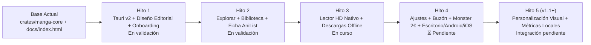

# Roadmap de Mangora · App Multiplataforma (Escritorio + Android + iOS · Tauri v2)

**Mangora** es la aplicación nativa multiplataforma (Escritorio en Windows/macOS/Linux + Móvil en **Android e iOS**) pensada para el público general (*normie*) construida sobre el motor Rust existente de `manga-tui` ([`crates/manga-core`](crates/manga-core)). Vive dentro de este mismo workspace en `apps/mangora/` usando **Tauri v2 + React + TypeScript + Vite + Tailwind CSS**. En escritorio comparte exactamente el mismo directorio de datos que `manga-tui` (`config.toml`, `history/manga-tui-history.db`, `mangaDownloads/`, `errorLogs/`) para mantener compatibilidad total entre ambas interfaces; en Android e iOS usa el sandbox privado del sistema (`app_data_dir` / `app_config_dir` / `app_cache_dir`, `StorageMode::AppSandbox`) y se mantiene sincronizado con el escritorio mediante Google Drive.

> [!IMPORTANT]
> **Frontera de alcance:** La **Estantería Digitalizada 3D** (con grosor dinámico en escala logarítmica y personalización de baldas/muebles) queda reservada para un **proyecto independiente 100 % legal y publicable en tiendas oficiales**. **Mangora** se centra en ofrecer una interfaz limpia, táctil y sin terminal para escritorio, Android e iOS sobre `crates/manga-core` (con personalización visual de la UI en la v1.1+).

---

## Mapa de Hitos

| Hito | Estado | Objetivo principal |
| :--- | :--- | :--- |
| **Hito 1** | En validación | Scaffold Tauri v2 multiplataforma en `apps/mangora/`, sistema de diseño editorial (`docs/index.html`), shell móvil (`BottomNav` + *safe areas*) y Onboarding |
| **Hito 2** | En validación | Explorar/Buscar con portadas HD y bloque *"Para ti"*, Biblioteca compartida SQLite y Ficha de serie completa con capítulos, AniList y Discord |
| **Hito 3** | En curso | Lector HD nativo táctil y de escritorio (online + 100 % offline en CBZ/RAW/EPUB/PDF) y gestor de cola de descargas en tiempo real |
| **Hito 4** | ⏳ Pendiente | Ajustes simples (Drive/AniList/MAL con *deep links* en móvil), Buzón seguro, *"¿Me invitas a un Monster? ⚡ 2 €"* y empaquetado Windows/Android/iOS |
| **Hito 5 (v1.1+)** | Módulos en `MANGORA`, integración pendiente | Personalización visual avanzada de temas/tarjetas y métricas locales ampliadas del lector |

---

## Estado de la app y cambios integrados

El trabajo de Mangora está reunido en `manga-tui/`, rama `MANGORA`. La aplicación vive en `apps/mangora/` y comparte el motor Rust de `crates/manga-core/`.

| Área | Disponible ahora | Pendiente |
| :--- | :--- | :--- |
| Base y navegación | Proyecto Tauri v2 multiplataforma (escritorio + base Android/iOS) con React, TypeScript, Vite (`TAURI_DEV_HOST`) y Tailwind; `Sidebar` en escritorio y `BottomNav` táctil en móvil con `viewport-fit=cover`, `safe-area-inset-*`, `h-dvh`, objetivos `>= 44px` y temas Papel/Tinta. | Validar la ventana nativa en Windows y ejecutar `tauri android init` / `tauri ios init` con los SDKs de cada plataforma. |
| Primer inicio | Selección de idioma, géneros y proveedor recomendado; detección de biblioteca previa; tour que se puede repetir desde Ajustes. Un fallo al guardar muestra el error y permite reintentar. | Validación manual completa en la app nativa. |
| Explorar | Búsqueda por título en el proveedor activo (`search_catalog` + `multi_provider`), bloque *«Para ti según tus gustos»* (`get_for_you_recommendations`), portadas HD, paginación, filtros por idioma/género en resultados visibles, favorito en 1 clic (`toggle_library_favorite`) y apertura directa de la Ficha de serie. | Validación en red real contra proveedores activos y filtros aplicados a todo el catálogo remoto. |
| Biblioteca y ficha de serie | Biblioteca visual interactiva conectada a `history/manga-tui-history.db` (`get_library_overview`, `toggle_library_favorite`) con pestañas **Continuar leyendo**, **Siguiendo / Favoritos** e **Historial reciente**, y **Ficha de serie completa** (`SeriesDetailView`, `get_series_detail`, `toggle_chapter_read`, `get_anilist_community`) abierta desde Inicio y Explorar con capítulos online/offline, marcación leído/pendiente en SQLite, reseñas/etiquetas públicas de AniList y enlace a Discord. | Validación manual con red real, Lector HD nativo dentro de Mangora (el botón de capítulo enlaza de momento un aviso hacia Hito 3) y controles de cola en Descargas. |
| Ajustes y apoyo | Cambio de idioma, tema, proveedor y géneros; apertura de la carpeta de datos; enlaces a Discord y GitHub. | Drive y trackers guiados, buzón de opiniones, donaciones activas y paquete instalable. |
| Apariencia y métricas | Módulos, migración y componentes del hito 5 presentes en el repositorio. | Registrar sus comandos Tauri e incorporar sus componentes a las pantallas. |

Para probar la app de escritorio en Windows, ejecutar `npm.cmd install` y `npm.cmd run tauri dev` desde `apps/mangora/`. `npm.cmd run dev` abre la vista previa web en `http://localhost:1420`; la búsqueda del catálogo requiere Tauri. La compilación de Vite, `cargo check --workspace --locked --offline` y las pruebas activas del workspace pasaron. En Chromium se verificaron el tour, el reintento tras un fallo de guardado y la búsqueda con respuestas simuladas. La prueba de red con MangaDex falló por falta de conexión en el entorno de pruebas, y allí la ventana nativa devolvió «Acceso denegado».

---

## Sistema de Diseño Editorial (heredado de `docs/index.html`)

Toda la interfaz gráfica de **Mangora** debe seguir fielmente la estética de papel manga y tinta definida en [`docs/index.html`](docs/index.html):

### Paleta de colores

- **Modo Papel (por defecto):**
  - Fondo principal (`--paper`): `#f8f7f1`
  - Superficie secundaria / tarjetas destacadas: `#ecebe3`
  - Tinta / texto y bordes (`--ink`): `#191918`
  - Acento rojo (`--red`): `#cb3028` (hover `#a1201b`)
  - Texto secundario (`--muted`): `#55554f`
  - Líneas y divisores (`--line`): `#c8c7bc`
  - Anillo de foco accesible (`:focus-visible`): `3px solid #0077b6` (`outline-offset: 4px`)
- **Modo Tinta (oscuro opcional para lectura nocturna):**
  - Fondo principal: `#141413`
  - Superficie / tarjetas: `#1f1f1d`
  - Tinta clara / texto principal: `#f8f7f1`
  - Acento rojo adaptado sobre oscuro: `#ff8a76` / `#cb3028`
  - Líneas / bordes secundarios: `#3a3a35`

### Tipografía

- **Display / Titulares:** `"Arial Black", "Archivo Black", Arial, sans-serif` (`letter-spacing: -0.065em`, `line-height: 1.04`, peso `900`)
- **Cuerpo / UI general:** `"Segoe UI", Arial, sans-serif`
- **Metadatos, etiquetas, *eyebrows* y barras técnicas:** `"Cascadia Mono", Consolas, "Courier New", monospace`

### Lenguaje visual obligatorio

- Bordes sólidos de alto contraste (`2px solid var(--ink)` o `1px solid var(--ink)` en controles secundarios).
- Sombras duras desplazadas sin difuminado (`3px 3px var(--ink)` en botones/inputs y `6px 6px var(--ink)` en tarjetas o visor principal).
- Bloques de énfasis con barra lateral roja (`border-left: 0.4rem solid var(--red)`).
- Tramas de puntos tipo *screentone* para acentos visuales (`radial-gradient(var(--red) 1px, transparent 1.4px) 0 0 / 6px 6px`).
- Barras de herramientas del lector en tinta negra (`background: var(--ink)`) con texto claro y controles nítidos.
- **Evitar** *glassmorphism*, transparencias borrosas genéricas, degradados SaaS o bordes excesivamente redondeados que rompan la estética editorial de papel y tinta.

---

## Arquitectura y módulos de `crates/manga-core` a reutilizar

### Disposición del workspace

- [`crates/manga-core`](crates/manga-core): motor Rust compartido entre `manga-tui` y **Mangora**. Módulos clave en [`crates/manga-core/src/backend`](crates/manga-core/src/backend):
  - Catálogo y fuentes: `multi_provider`, `manga_provider`, `html_parser`, `cache`
  - Persistencia y descargas: `database`, `migration`, `download_queue`, `manga_downloader`, `offline`
  - Sincronización y trackers: `cloud`, `tracker` (AniList + MyAnimeList), `secrets`
  - Utilidades y soporte: `web_viewer`, `updater`, `release_notifier`, `error_log`, `config`, `i18n`, `runtime_settings`
- [`src/`](src): binario CLI/TUI `manga-tui` (debe permanecer 100 % operativo y sin regresiones).
- `apps/mangora/src-tauri/`: crate Rust de Tauri v2 conectado al workspace (`Cargo.toml`) que expone comandos `#[tauri::command]` y eventos en tiempo real sobre `manga-core`.
- `apps/mangora/src/`: frontend en **React + TypeScript + Vite + Tailwind CSS**.

### Almacenamiento compartido (`AppDirectories`) y soporte móvil (Android + iOS)

Definido en [`crates/manga-core/src/backend.rs`](crates/manga-core/src/backend.rs) y [`crates/manga-core/src/config.rs`](crates/manga-core/src/config.rs), respetando la precedencia en escritorio (`MANGA_TUI_DATA_DIR` > modo portable `data/` > directorio estándar del sistema) y el sandbox de app en Android/iOS (`StorageMode::AppSandbox` vía `set_custom_data_dir`, `set_custom_config_dir` y `set_custom_cache_dir`):

- `config.toml` — preferencias y estado general
- `history/manga-tui-history.db` — biblioteca, favoritos, progreso de lectura e historial SQLite
- `mangaDownloads/` — capítulos descargados en formatos `CBZ`, `RAW`, `EPUB` y `PDF`
- `errorLogs/manga-tui-error-logs.txt` — registros de error

**Base técnica móvil integrada:**
- Entry point `#[cfg_attr(mobile, tauri::mobile_entry_point)]` en [`apps/mangora/src-tauri/src/lib.rs`](apps/mangora/src-tauri/src/lib.rs) con inyección de `app_data_dir`, `app_config_dir` y `app_cache_dir` (incluyendo caché de MangaDex).
- `tauri-plugin-opener` (`OpenerExt`) para abrir enlaces HTTPS en desktop/Android/iOS y carpetas en desktop (`capabilities/default.json` cross-platform + `capabilities/desktop.json` para permisos de ventana).
- En `crates/manga-core`: `reqwest` usa `rustls-tls-native-roots` en escritorio y `rustls-tls-webpki-roots` en Android/iOS; `keyring` usa `windows-native` (Windows), `apple-native` (macOS + iOS Keychain), `sync-secret-service` (Linux) y fallback en sandbox para Android.
- `InitialAppState` expone `platform`, `isMobile` y `canOpenDataFolder` para adaptar botones de sistema de archivos en móvil.
- `vite.config.ts` preparado con `TAURI_DEV_HOST` y `envPrefix` para depuración en emulador o dispositivo físico (`tauri android dev` / `tauri ios dev`).

---

## Hito 1 · Base Tauri v2, Estética `index.html` y Onboarding de Primeros Pasos

- **Estado:** `En validación`

El ejecutable de Windows compila. El asistente permite reintentar un guardado fallido y conserva la selección. Queda por comprobar la apertura de la ventana nativa en una sesión de escritorio: Tauri devolvió «Acceso denegado» en el entorno de pruebas.

### Prompt sugerido para nuevo hilo

> Lee `MANGORA_ROADMAP.md` y `docs/index.html`. Vamos a ejecutar el **Hito 1**: crea el proyecto Tauri v2 + React + TypeScript + Vite + Tailwind CSS en `apps/mangora/` integrado con `crates/manga-core`, implementa el sistema de diseño Papel/Tinta, el shell de navegación principal y el flujo de Onboarding de primeros pasos (idioma, gustos/géneros, servidor recomendado y mini-tour).

### Alcance técnico y entregables

1. **Scaffold en el workspace (`apps/mangora/`):**
   - Configurar `apps/mangora/src-tauri/` con Tauri v2 enlazando `manga-core = { path = "../../../crates/manga-core" }` (y actualizar miembros del workspace raíz en `Cargo.toml` cuidando que `cargo check` y `cargo test` sigan funcionando en `manga-tui`).
   - Configurar `apps/mangora/` con Vite + React + TypeScript + Tailwind CSS.
2. **Design System Papel y Tinta:**
   - Variables CSS y clases base replicando la estética editorial de `docs/index.html` (Modo Papel `#f8f7f1` por defecto y toggle a Modo Tinta `#141413`), tipografía display/cuerpo/mono, sombras duras, bordes `2px` y detalles *screentone*.
   - Shell principal con navegación clara para *normies*: **Inicio / Biblioteca**, **Explorar**, **Descargas**, **Ajustes** y acceso directo a **Apoyar / Discord**.
3. **Comandos Tauri iniciales (`src-tauri`):**
   - Inicializar entorno de datos compartidos de `manga-core` sin abrir consola negra en Windows.
   - Comando para leer estado inicial: idioma, modo de almacenamiento activo, y detección automática de si ya existe biblioteca/historial previo de `manga-tui`.
   - Comandos para guardar las preferencias del Onboarding (idioma, géneros de interés, proveedor/servidor recomendado y flag de onboarding completado).
4. **Onboarding de Primeros Pasos (*User*):**
   - Paso 1: Selección de idioma (`Español` / `English`) con cambio inmediato de textos.
   - Paso 2: Selección de gustos/géneros favoritos (p. ej. *Shonen*, *Seinen*, *Romance*, *Fantasía*, *Slice of Life*, etc.) y asignación automática del proveedor/servidor recomendado acorde al idioma (con opción clara de cambiarlo luego).
   - Paso 3: Si se detectan datos previos de `manga-tui`, mostrar aviso de *"Biblioteca detectada y lista"*; si está vacía, mini-tour guiado explicando qué hace cada sección (`Explorar`, `Biblioteca`, `Descargas`, `Ajustes`).
   - Permitir volver a lanzar el tour desde Ajustes.

### Criterios de aceptación

- [ ] `apps/mangora/` compila y arranca la ventana nativa Tauri v2 en Windows sin mostrar ventana de consola extra.
- [x] La UI aplica fielmente los tokens visuales de `docs/index.html` (Papel `#f8f7f1`, Tinta `#191918`, Rojo `#cb3028`, sombras duras y tipografía mono/display) y soporta cambio a Modo Tinta.
- [x] El Onboarding guarda idioma, gustos y proveedor recomendado, y no vuelve a mostrarse al reiniciar una vez completado.
- [x] `cargo check` y `cargo test` del workspace (`manga-tui` y `manga-core`) pasan sin regresiones.

---

## Hito 2 · Explorar, Biblioteca Visual y Ficha de Manga (AniList + Discord)

- **Estado:** `En validación`

Hito 2 está integrado en UI y backend: **Explorar** busca por proveedor (`search_catalog`), muestra el bloque *«Para ti según tus gustos»* (`get_for_you_recommendations`) y permite abrir la ficha o marcar favoritos; **Inicio** (`LibraryShelf`) conecta las pestañas **Continuar leyendo**, **Siguiendo / Favoritos** e **Historial reciente** al SQLite compartido (`get_library_overview`, `toggle_library_favorite`) y abre cualquier serie en la **Ficha de serie completa** (`SeriesDetailView`) con listado de capítulos conciliado contra lectura en SQLite (`toggle_chapter_read`) y descargas locales, indicador de siguiente capítulo pendiente, panel no bloqueante de comunidad **AniList** (`get_anilist_community`) y CTA a **Discord**. Queda pendiente la validación manual en `tauri dev` con red real frente a MangaDex/AniList (el botón *«Abrir lector»* queda enlazado a Hito 3).

Se verificaron la conciliación de capítulos, el ranking *«Para ti»*, el cliente GraphQL de AniList (con `httpmock`) y la escritura en SQLite mediante tests unitarios. La prueba de conexión real a MangaDex está en `apps/mangora/src-tauri/src/commands.rs` y requiere acceso de red.

### Prompt sugerido para nuevo hilo

> Lee `MANGORA_ROADMAP.md` y el estado actual de `apps/mangora/`. Vamos a ejecutar el **Hito 2**: conecta la pantalla Explorar/Buscar a `multi_provider`, la Biblioteca al SQLite compartido de `manga-core` y crea la Ficha de Serie con reseñas públicas de AniList y acceso a Discord.

### Alcance técnico y entregables

1. **Explorar y Buscar (`multi_provider`):**
   - Buscador rápido con portadas en HD, tarjetas editoriales táctiles (`>= 44px`) con borde sólido y sombra desplazada, filtros limpios por idioma, género/etiquetas y selector simple de proveedor (mostrando el recomendado primero).
   - Bloque inicial *"Para ti según tus gustos"* usando los géneros seleccionados en el Onboarding.
   - Manejo amigable de errores si un proveedor está caído o lento (mensajes claros para *normies* con sugerencia de probar otro proveedor).
2. **Inicio / Biblioteca compartida (`database.rs`):**
   - Leer y escribir directamente sobre `history/manga-tui-history.db` manteniendo compatibilidad 100 % bidireccional con `manga-tui` en escritorio (y sandbox local + Drive Sync en móvil).
   - Pestañas/secciones claras y usables en pantallas de 360px+ y escritorio: **Continuar leyendo**, **Siguiendo / Favoritos** e **Historial reciente**.
   - Acciones rápidas: marcar/quitar favorito, ver último capítulo leído y abrir siguiente capítulo pendiente en 1 clic/toque.
3. **Ficha de Serie + AniList + Discord:**
   - Vista detalle adaptable (2 columnas en escritorio, apilada en móvil) con portada grande, título, autor/estado, sinopsis, géneros y listado de capítulos ordenado con indicador claro de *Leído*, *Descargado (Offline)* y *Disponible online*.
   - **Sección de Comunidad en ficha:** consultar puntuación media, etiquetas y reseñas/comentarios públicos desde la API de **AniList** (solo lectura, sin necesidad de cuenta) + botón visible para comentar y charlar en el **Discord** oficial.

### Criterios de aceptación

- [ ] Buscar un manga devuelve portadas y resultados reales desde `multi_provider` y permite filtrar por idioma/proveedor tanto en escritorio como en móvil.
- [ ] Marcar favoritos o abrir capítulos desde Mangora actualiza `history/manga-tui-history.db` y se refleja correctamente al abrir `manga-tui` (y viceversa).
- [ ] La Ficha de Serie muestra capítulos online/descargados y carga valoración/reseñas públicas de AniList de forma no bloqueante (con fallback limpio si AniList no encuentra la serie o falla la red).
- [x] `cargo check` y `cargo test` pasan en todo el workspace.

---

## Hito 3 · Lector HD Nativo (Online + 100 % Offline) y Gestor de Descargas

- **Estado:** `En curso`

El backend ya conserva preferencias del lector y formato de descarga, y `manga-core` incorpora acceso a capítulos locales y cola de descargas. La pantalla de Descargas muestra información y permite abrir la carpeta de datos. Falta conectar la lectura y la cola a la interfaz de Mangora.

### Prompt sugerido para nuevo hilo

> Lee `MANGORA_ROADMAP.md` y el estado actual de `apps/mangora/`. Vamos a ejecutar el **Hito 3**: construye el Lector HD nativo dentro de Mangora (cascada, página única y doble página, online y 100 % offline con CBZ/RAW/EPUB/PDF) y la pantalla de Cola de Descargas conectada a `manga-core`.

### Alcance técnico y entregables

1. **Lector HD integrado (estilo barra de tinta de `docs/index.html`):**
   - Modos de lectura seleccionables en barra superior/inferior retráctil: **Cascada vertical (*Webtoon*)**, **Página única** y **Doble página**.
   - Dirección de lectura: **Manga (derecha → izquierda)** y **Occidental (izquierda → derecha)**.
   - Controles cómodos para *normies*: zoom / ajuste a ancho o alto, barra de progreso por página, precarga en segundo plano de las siguientes páginas y capítulos anterior/siguiente.
   - Atajos de escritorio (clic lateral / rueda, `←`, `→`, `Espacio`, `F` pantalla completa, `Esc`) y **gestos táctiles móviles** (tap en zonas izquierda/centro/derecha, *swipe* horizontal entre páginas, *pinch-to-zoom* / doble tap, modo cascada móvil fluido y barras retráctiles cómodas para el pulgar respetando `safe-area-inset-*`).
   - Guardado automático de progreso (capítulo + página actual) en SQLite.
2. **Lectura 100 % Offline (`offline.rs`):**
   - Servir páginas de capítulos descargados en `mangaDownloads/` en los 4 formatos soportados (`CBZ`, `RAW`, `EPUB`, `PDF`) mediante protocolo/comando Tauri eficiente en memoria.
   - Detección automática sin conexión: si no hay internet o el capítulo ya está descargado, abrir directamente desde local mostrando el distintivo `OFFLINE / LOCAL`.
3. **Gestor y Cola de Descargas (`download_queue.rs` / `manga_downloader.rs`):**
   - Botón de descarga individual o selección múltiple de capítulos desde la ficha del manga.
   - Pantalla **Descargas** con cola activa en tiempo real (eventos Tauri de progreso, velocidad/estado, pausar/cancelar/reintentar), selector de formato (`CBZ` por defecto, `PDF`, `EPUB`, `RAW`) y botón para abrir la carpeta en el Explorador en escritorio (o aviso de almacenamiento sandbox en móvil).

### Criterios de aceptación

- [ ] El lector carga capítulos online y offline con los 3 modos de vista (cascada, página única, doble página), soporta ratón/teclado en escritorio y gestos táctiles en móvil, y recuerda el modo/sentido preferido del usuario.
- [ ] Los capítulos descargados en `CBZ`, `RAW`, `EPUB` y `PDF` se leen completamente sin conexión a internet y reconcilian el estado leído en SQLite.
- [ ] La pantalla de Descargas refleja el progreso en vivo desde `download_queue` y adapta las acciones de carpeta según `canOpenDataFolder`.
- [ ] `cargo check` y `cargo test` pasan sin regresiones.

---

## Hito 4 · Ajustes Sencillos, Buzón de Opiniones, "Monster ⚡ 2 €" y Empaquetado Multiplataforma

- **Estado:** `⏳ Pendiente`

Ya se pueden cambiar idioma, tema, proveedor y géneros desde Ajustes, repetir el tour y abrir la carpeta de datos en escritorio. Apoyar incluye enlaces a Discord y GitHub; el bloque de Monster todavía es informativo.

### Prompt sugerido para nuevo hilo

> Lee `MANGORA_ROADMAP.md` y el estado actual de `apps/mangora/`. Vamos a ejecutar el **Hito 4**: implementa Ajustes simplificados (Drive, AniList/MAL con soporte OAuth en escritorio y móvil), el Buzón de opiniones seguro, la sección de apoyo *"¿Me invitas a un Monster? ⚡ 2 €"* + Discord y el empaquetado Windows, Android e iOS de Mangora.

### Alcance técnico y entregables

1. **Ajustes Sencillos para *normies*:**
   - Cambiar idioma, tema Papel / Tinta, proveedor recomendado y relanzar el Onboarding/Tour cuando el usuario quiera.
   - Integración guiada en 1 clic de **Google Drive Cloud Sync** (`cloud.rs`), **AniList / MyAnimeList** (`tracker`) con soporte OAuth mediante callback local en escritorio y *deep links* / URL schemes en Android e iOS, más carpeta local personalizada con botón para abrir ubicación en el Explorador en escritorio.
   - Comprobador de actualizaciones no intrusivo (`updater.rs` / `release_notifier.rs`) adaptado a las releases de Mangora.
2. **Buzón de Opiniones y Reporte de Fallos nativo:**
   - Modal o pestaña accesible desde Ajustes y barra principal con 3 campos claros: **Categoría** (*Sugerencia*, *Fallo técnico*, *Proveedor roto*), **Mensaje** y casilla opcional (*"Adjuntar versión de app y sistema operativo"*).
   - **Seguridad anti-abuso:** enviar el formulario a través de un **micro-proxy gratuito con *rate-limit*** (p. ej. Cloudflare Worker que reenvíe a un canal privado de Discord o cree un Issue); **nunca** incrustar un webhook secreto directo dentro del binario compilado.
   - Incluir enlace fallback directo a GitHub Issues / correo si el servicio de buzón no estuviera configurado.
3. **Apoyo Voluntario ("¿Me invitas a un Monster? ⚡ 2 €") y Comunidad:**
   - Botón editorial amigable en la barra lateral y en Ajustes: **"¿Me invitas a un Monster? ⚡ 2 €"** + opción de cantidad libre apuntando a **Ko-fi** (no exige cuenta para donar), acompañado de enlace secundario a **GitHub Sponsors** y enlace al servidor de **Discord**.
   - Banner/recordatorio sutil, opcional y descartable de forma permanente tras alcanzar ciertos hitos de lectura (nunca bloqueando capítulos, funciones ni descargas).
   - Tarjeta de **Agradecimientos (*Supporters*)** dentro de la pantalla de Apoyo.
4. **Empaquetado y Distribución Multiplataforma (Windows + Android + iOS):**
   - **Windows:** configurar `tauri.conf.json` con icono `.ico`, metadatos Win32, identificador único y generación de instalador Windows (NSIS / Inno Setup / MSI) + ejecutable portable si aplica.
   - **Android:** inicializar `tauri android init` (requiere Android NDK y targets Rust `aarch64-linux-android` / `armv7-linux-androideabi` / `x86_64-linux-android`) y generar APK / AAB firmado.
   - **iOS:** inicializar `tauri ios init` desde macOS + Xcode (targets `aarch64-apple-ios` / `aarch64-apple-ios-sim`) y generar IPA / archive.
   - Añadir/ajustar script de build o workflow en `.github/workflows/` para compilar Mangora sin romper los workflows ni el instalador actuales de `manga-tui`.

### Criterios de aceptación

- [ ] Ajustes permite cambiar tema, idioma, proveedor recomendado y gestionar Google Drive Sync y AniList/MAL sin usar comandos de terminal tanto en escritorio como en Android/iOS (*deep links*).
- [ ] El Buzón de Opiniones valida campos, muestra confirmación/error comprensible y no expone credenciales ni webhooks privados en el código fuente o binario.
- [ ] La sección de apoyo muestra la opción *"¿Me invitas a un Monster? ⚡ 2 €"* (Ko-fi), GitHub Sponsors y Discord de forma totalmente voluntaria y sin muros de pago.
- [ ] Los paquetes de instalación de Mangora (Windows, Android APK/AAB e iOS IPA en macOS) se generan correctamente y conviven sin conflictos con el instalador de `manga-tui`.

---

## Hito 5 (v1.1+) · Personalización Visual Avanzada y Métricas del Lector

- **Estado:** Módulos presentes en `MANGORA`. Falta conectar los comandos Tauri y los componentes a las pantallas de la app.

### Prompt sugerido para nuevo hilo

> Lee `MANGORA_ROADMAP.md` y el estado actual de `apps/mangora/`. Vamos a ejecutar el **Hito 5**: añade personalización visual avanzada (paletas editoriales extra, densidad/vista de biblioteca) y métricas locales ampliadas del lector.

### Alcance técnico y entregables

1. **Personalización visual de la interfaz:**
   - Paletas editoriales adicionales inspiradas en papel y manga (*Papel Clásico*, *Tinta Nocturna*, *Sepia Editorial*, *Shonen Rojo*, *Sumi Grafito*), guardadas atómicamente en `[mangora_appearance]` dentro de `config.toml`.
   - Opciones de visualización en Biblioteca y Explorar: tamaño/densidad de tarjetas (`compact`, `comfortable`, `spacious`), vista cuadrícula/lista, ordenación personalizada y 7 fondos sutiles de lectura (`theme_default`, `pure_paper`, `warm_sepia`, `soft_gray`, `matte_ink`, `pitch_black`, `subtle_screentone`).
2. **Métricas locales para el lector (100 % privadas en dispositivo):**
   - Migración SQLite `0.12.0` (`reading_sessions` 100 % local y `manga_genres` con índices) manteniendo compatibilidad total hacia atrás con `manga-tui` y `LibrarySyncSnapshot` (solo `manga_genres` sincroniza como metadato; `reading_sessions` nunca sale del equipo).
   - Cálculo de estadísticas locales sin doble conteo (`ExtendedReaderMetrics`): capítulos leídos (hoy / 7d / 30d / total), tiempo real/estimado, promedio por capítulo, rachas actual y máxima, top géneros, top series, actividad diaria de 14 días y vista/tarjeta editorial SVG (`1200×675`) exportable a **SVG** y **PNG 2x**.

### Archivos del hito 5 en `MANGORA`

- **Backend compartido (`crates/manga-core`):** [`mangora_appearance.rs`](crates/manga-core/src/mangora_appearance.rs), [`config.rs`](crates/manga-core/src/config.rs), [`migration.rs`](crates/manga-core/src/backend/migration.rs), [`database.rs`](crates/manga-core/src/backend/database.rs), [`cloud.rs`](crates/manga-core/src/backend/cloud.rs), [`database_scheme.md`](crates/manga-core/src/backend/database_scheme.md), [`mangora_metrics_card.rs`](crates/manga-core/src/mangora_metrics_card.rs), [`mangora_hito5_api.rs`](crates/manga-core/src/mangora_hito5_api.rs), [`lib.rs`](crates/manga-core/src/lib.rs).
- **Módulos UI autocontenidos (`apps/mangora/src/features/hito5/`):** [`types.ts`](apps/mangora/src/features/hito5/types.ts), [`palettes.css`](apps/mangora/src/features/hito5/palettes.css), [`palettes.ts`](apps/mangora/src/features/hito5/palettes.ts), [`bridge.ts`](apps/mangora/src/features/hito5/bridge.ts), [`sorting.ts`](apps/mangora/src/features/hito5/sorting.ts), [`useMangoraAppearance.ts`](apps/mangora/src/features/hito5/useMangoraAppearance.ts), [`useReaderMetrics.ts`](apps/mangora/src/features/hito5/useReaderMetrics.ts), [`AppearanceCustomizerPanel.tsx`](apps/mangora/src/features/hito5/components/AppearanceCustomizerPanel.tsx), [`CollectionDisplayToolbar.tsx`](apps/mangora/src/features/hito5/components/CollectionDisplayToolbar.tsx), [`ReaderMetricsDashboard.tsx`](apps/mangora/src/features/hito5/components/ReaderMetricsDashboard.tsx), [`tauriCommandsTemplate.rs`](apps/mangora/src/features/hito5/tauriCommandsTemplate.rs), [`index.ts`](apps/mangora/src/features/hito5/index.ts), [`INTEGRATION.md`](apps/mangora/src/features/hito5/INTEGRATION.md).

### Criterios de aceptación

- [ ] Los temas y ajustes de densidad se aplican en vivo y persisten entre reinicios.
- [x] Las métricas se calculan y almacenan 100 % en local sin telemetría oculta ni envío externo de hábitos de lectura.
- [x] Cualquier cambio en la base de datos SQLite conserva compatibilidad total con `manga-tui` y pasa las pruebas de migración y `cargo test`.

---

## Acceso entre MANGORA y manga-tui en escritorio

**Pendiente tras completar el recorrido ficha → capítulos → lectura en MANGORA.**

- Mantener MANGORA y `manga-tui` como aplicaciones con sus propios ejecutables y accesos directos. MANGORA conserva el flujo de ratón y `manga-tui` el de terminal y teclado.
- Compartir la biblioteca, las descargas y el progreso de lectura a través de `manga-core` para poder retomar un manga desde cualquiera de las dos. Mantener el tema y las preferencias visuales de cada interfaz por separado.
- Añadir **Abrir manga-tui** en Ajustes de MANGORA y **Abrir MANGORA** en el menú de `manga-tui`. Las acciones aparecen cuando se detecta la otra aplicación instalada.
- Verificar que ambos accesos abren la aplicación correspondiente y que el progreso guardado en una se puede retomar en la otra.

## Reglas y Convenciones para Futuros Hilos

1. **Contexto obligatorio al empezar:** leer este archivo (`MANGORA_ROADMAP.md`) y [`docs/index.html`](docs/index.html) antes de diseñar o escribir código nuevo de Mangora.
2. **Compatibilidad con `manga-tui`:** nunca romper el binario CLI/TUI ni su almacenamiento compartido; ejecutar `cargo fmt --all --check`, `cargo check` y `cargo test` en el workspace en cada hito.
3. **Actualización viva del roadmap:** al terminar un hito en un hilo, marcar sus checkboxes `- [x]`, actualizar el estado en la tabla y el diagrama Mermaid (`⏳ Pendiente` → `✅ Implementado`), y documentar cualquier ruta o archivo clave añadido.
4. **Privacidad, seguridad y legalidad:**
   - Cero telemetría oculta y cero venta o recolección comercial de datos de usuarios.
   - Las donaciones ("Monster ⚡ 2 €", Ko-fi, GitHub Sponsors) son estrictamente apoyo voluntario al desarrollo del software open-source y nunca desbloquean contenido con copyright ni proveedores.
   - La **Estantería Digitalizada 3D** con monetización comercial queda fuera de este repositorio y se desarrollará en un proyecto separado 100 % legal para tiendas oficiales.
