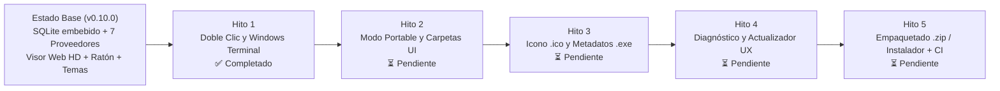

# Roadmap hacia el Ejecutable para PC (`manga-tui`)

Este documento define la hoja de ruta por hitos para evolucionar **`manga-tui`** desde una aplicación CLI/TUI compilada en local hasta un **ejecutable nativo para PC (Windows)** completo — con experiencia TUI nativa + Visor Web HD, apertura directa con doble clic en Windows Terminal, versión Portable `.zip` e Instalador.

---

## Estado Base (v0.10.0)

El proyecto ya cuenta con una base sólida y autocontenida en Rust para ejecutarse sin dependencias externas de sistema:

- **Base de datos embebida**: `rusqlite` compilado con `features = ["bundled"]` (no requiere instalar SQLite).
- **Red y TLS nativos**: `reqwest` con `rustls-tls-native-roots` (no depende de OpenSSL externo).
- **7 Proveedores + Fallback español**: MangaDex, InManga, MangaOni, LeerCapitulo, WeebCentral, MangaPill y Comizy, con comprobación de salud en segundo plano al arranque.
- **Múltiples formatos de descarga**: `CBZ`, `PDF`, `EPUB` y `RAW`.
- **Lectura TUI + Visor Web HD**: renderizado gráfico en terminal (`ratatui-image`) y servidor local HTTP (`src/backend/web_viewer.rs`) para lectura en navegador a máxima resolución.
- **Interfaz moderna**: temas intercambiables en vivo (`Tokyo Night`, `Catppuccin`, `Classic`), soporte completo de ratón, Hub de descubrimiento global y localización ES/EN.

---

## Hito 1 — Experiencia Nativa en Windows ("Double-Click Ready") ✅

**Objetivo:** Que hacer doble clic en `manga-tui.exe` desde el Explorador de Windows ofrezca una experiencia inmediata, nítida y sin cierres silenciosos.

- [x] **Codificación UTF-8 automática**: Configurar `SetConsoleCP(65001)` y `SetConsoleOutputCP(65001)` al inicio en Windows para garantizar bordes Unicode, iconos Nerd/UTF-8 y textos en español sin caracteres rotos.
- [x] **Título de ventana nativo**: Establecer el título de la consola/terminal (`Manga TUI v0.10.0`) mediante `SetTitle`.
- [x] **Relanzamiento inteligente en Windows Terminal (`wt.exe`)**: Detectar si el ejecutable se abrió directamente en una consola independiente clásica (`GetConsoleProcessList == 1`) fuera de un terminal moderno; en ese caso, relanzar automáticamente en **Windows Terminal maximizado** (`wt.exe -M new-tab --title "Manga TUI"`) pasando argumentos y directorio de trabajo.
- [x] **Detección inteligente de protocolo de imagen**: Usar `Sixel` automáticamente en terminales modernas de Windows (`Windows Terminal`, `VS Code`, `WezTerm`, `Alacritty`, `Mintty`, `Rio`, `Tabby`, `Hyper`, `Kitty`) y conservar `Halfblocks` limpio si se ejecuta en `conhost.exe` clásico sin soporte Sixel.
- [x] **Pausa amigable ante errores fatales**: Si el arranque falla al abrirse por doble clic en consola independiente, mostrar el error y esperar `Enter` antes de cerrar la ventana.

---

## Hito 2 — Modo Portable y Gestión de Carpetas desde la UI ⏳

**Objetivo:** Permitir llevar toda la biblioteca, configuración e historial en un pendrive o carpeta autocontenida, y abrir las carpetas locales directamente desde la interfaz.

- [ ] **Detección automática de modo portable**: Si existe `portable.txt` o una carpeta `data/` junto a `manga-tui.exe`, almacenar `config.toml`, `manga-tui-history.db`, `errorLogs/` y `mangaDownloads/` dentro de esa carpeta local en lugar de `%APPDATA%` / `%LOCALAPPDATA%`.
- [ ] **Acceso directo a carpetas desde Ajustes e Inicio**: Añadir opción/atajo (`<o>`) y botón clicable para abrir `mangaDownloads` y la carpeta de configuración en el Explorador de Windows (`open::that`).
- [ ] **Indicador de modo en la UI**: Mostrar en Ajustes/Inicio si la app está ejecutándose en modo `Portable` o `Instalado (Sistema)`.

---

## Hito 3 — Identidad Visual del Ejecutable (`.exe` con Icono y Metadatos) ⏳

**Objetivo:** Que `manga-tui.exe` tenga aspecto de programa nativo profesional en el Explorador de Windows, barra de tareas y Propiedades del archivo.

- [ ] **Icono oficial (`assets/icon.ico`)**: Diseñar/incluir un icono multi-resolución (`16x16`, `32x32`, `48x48`, `256x256`).
- [ ] **Script `build.rs` para Windows**: Integrar `winresource` (solo en `#[cfg(windows)]` / `target_os = "windows"`) para incrustar el icono `.ico` y los metadatos (`ProductName`, `FileDescription`, `FileVersion`, `LegalCopyright`) dentro del binario final.
- [ ] **Verificación de propiedades del binario**: Comprobar que el `.exe` compilado con `--release` muestra icono y detalles de versión en Windows.

---

## Hito 4 — Diagnóstico Integrado, Actualizador y Pulido UX (Release Candidate) ⏳

**Objetivo:** Eliminar la necesidad de usar la línea de comandos para diagnosticar problemas, actualizar o configurar la aplicación.

- [ ] **Re-comprobación manual de proveedores en Ajustes**: Botón/atajo para re-ejecutar el healthcheck de proveedores sin reiniciar la app.
- [ ] **Notificación interactiva de nueva versión**: Mostrar aviso en Inicio cuando haya una versión más nueva en GitHub y permitir abrir la página de descarga/release con un clic o tecla.
- [ ] **Revisión integral ratón + teclado**: Verificar que todas las pantallas (`Inicio`, `Buscar`, `Feed`, `Manga`, `Lector`, `Ajustes`, `Ayuda`) sean cómodas tanto con ratón como con teclado tras abrir por doble clic.

---

## Hito 5 — Empaquetado para PC (`.zip` Portable + Instalador) y CI/CD ⏳

**Objetivo:** Generar con un solo comando (y automáticamente en cada release de GitHub) los artefactos listos para cualquier usuario de Windows.

- [ ] **Script local de empaquetado (`scripts/package-windows.ps1`)**: Compilar `cargo build --release`, copiar `manga-tui.exe`, `README.md`, `LICENSE` y crear `portable.txt` para generar `manga-tui-v<ver>-windows-x86_64-portable.zip`.
- [ ] **Instalador de Windows**: Script de instalador (Inno Setup `.iss` o MSIX/WiX) con acceso directo en Menú Inicio / Escritorio, desinstalador y registro opcional en `PATH`.
- [ ] **Pipeline de GitHub Actions (`.github/workflows/release.yml`)**: Añadir `x86_64-pc-windows-msvc` (`windows-latest`) a la matriz de releases para publicar el `.zip` portable e instalador de Windows junto con las builds de Linux y macOS.
