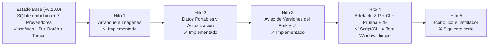

# Roadmap hacia el Ejecutable para PC (`manga-tui`)

Este documento define la hoja de ruta por hitos y los **criterios de aceptación** para publicar **`manga-tui`** como un ejecutable nativo para Windows (primero como **ZIP Portable** listo para descargar, abrir con doble clic y actualizar sin perder datos, y en el siguiente corte como **Instalador** con icono `.ico`).

---

## Estado Base (v0.10.0)

El binario en Rust ya es autocontenido para ejecutarse sin instalar dependencias externas:

- **Base de datos embebida**: `rusqlite` compilado con `features = ["bundled"]` (sin SQLite externo).
- **Red y TLS nativos**: `reqwest` con `rustls-tls-native-roots` (sin OpenSSL externo).
- **7 Proveedores + Fallback español**: MangaDex, InManga, MangaOni, LeerCapitulo, WeebCentral, MangaPill y Comizy.
- **Descargas y lectura**: formatos `CBZ`, `PDF`, `EPUB` y `RAW`, lector en terminal (`ratatui-image`) y **Visor Web HD** (`src/backend/web_viewer.rs`).

---

## Hito 1 · Arranque e imágenes ("Double-Click Ready") ✅

**Implementado en:** [src/main.rs](src/main.rs), [src/backend/tui.rs](src/backend/tui.rs), [src/config.rs](src/config.rs), [src/view/widgets/settings.rs](src/view/widgets/settings.rs), [src/view/pages/reader.rs](src/view/pages/reader.rs), [src/view/pages/manga.rs](src/view/pages/manga.rs), [src/view/app.rs](src/view/app.rs)

- **Codificación UTF-8 y título**: `SetConsoleCP(65001)` / `SetConsoleOutputCP(65001)` y título `Manga TUI v<versión>` mediante `SetTitle`.
- **Relanzamiento en Windows Terminal (`wt.exe`) y detección ConPTY**: Si se abre `manga-tui.exe` desde una consola independiente clásica (`GetConsoleProcessList == 1`) fuera de una terminal moderna y sin subcomandos CLI no interactivos, busca `wt.exe` (incluidos alias `WindowsApps\wt.exe` y `PATH`) y relanza maximizado en Windows Terminal. Además, `src/backend/tui.rs` detecta sesiones ConPTY / Windows 11 DefTerm (`GetConsoleWindow` + `IsWindowVisible`) incluso sin `WT_SESSION`.
- **Restauración de terminal y pausa ante errores fatales**: Un panic hook y el manejador de errores restauran la terminal (`restore_terminal_safely`) antes de imprimir el fallo y, en consola independiente, esperan `Enter` antes de cerrar la ventana.
- **Protocolo gráfico sin modo pixelado ilegible**: `src/backend/tui.rs` usa `Sixel` automáticamente en terminales modernas (`WT_SESSION`, `WEZTERM_EXECUTABLE`, `TERM_PROGRAM`, VS Code o ConPTY) y en `conhost.exe` clásico pasa directamente al **Visor Web HD (`<v>`)** en lugar de degradar a Halfblocks pixelados. Si se necesita otro protocolo gráfico (`sixel`, `kitty`, `iterm2`, `none`, `auto`), puede configurarse en Ajustes (`<c>` / `<F5>`), `config.toml` (`image_protocol`) o `MANGA_TUI_PROTOCOL`. Con `image_protocol = "none"` (o en terminales sin soporte Sixel), abrir un capítulo lanza automáticamente el **Visor Web HD (`<v>`)** sin bloqueo.

### Criterios de aceptación (Hito 1)
- [x] Tests unitarios de relanzamiento en Windows Terminal, búsqueda de `wt.exe`, detección de terminales modernos, precedencia de protocolo gráfico (`MANGA_TUI_PROTOCOL` > `config.toml` > `auto`) y fallback automático al **Visor Web HD (`<v>`)** en terminales sin protocolo gráfico o cuando `image_protocol = "none"`.
- [x] Probar `manga-tui.exe` abriéndolo con **doble clic desde el Explorador**, dentro de **Windows Terminal**, y desde la **consola clásica (`conhost.exe`)**.
- [x] Si en algún terminal no se renderizan imágenes en el lector TUI, seleccionar `Sixel` / `Visor Web HD` en Ajustes (`<c>`) o abrir el **Visor Web HD (`<v>`)** permite seguir leyendo sin bloqueo.

---

## Hito 2 · Datos portables y actualización ✅

**Implementado en:** [src/backend.rs](src/backend.rs), [src/config.rs](src/config.rs)

- **Precedencia estricta del directorio de datos y configuración**:
  1. `MANGA_TUI_DATA_DIR` (variable de entorno, máxima prioridad).
  2. `<carpeta_del_exe>/data/` si existe un archivo `portable.txt` o una carpeta `data/` junto a `manga-tui.exe` (**Modo Portable**).
  3. Directorio estándar del sistema (`directories::ProjectDirs` en `%APPDATA%` / `%LOCALAPPDATA%`).
- En modo **Portable** (o con `MANGA_TUI_DATA_DIR`), tanto `config.toml` como `history/manga-tui-history.db`, `errorLogs/` y `mangaDownloads/` se guardan dentro de esa misma carpeta unificada.
- **Nota sobre AniList (`keyring`)**: Las credenciales configuradas mediante el comando CLI `manga-tui anilist` se almacenan en el almacén seguro del sistema operativo (`keyring` / Administrador de credenciales de Windows). Al copiar la carpeta portable a otro PC, habrá que volver a configurarlas en ese equipo o definirlas explícitamente en la sección `[anilist]` de `data/config.toml`.

### Criterios de aceptación (Hito 2)
- [x] Tests unitarios de precedencia (`MANGA_TUI_DATA_DIR` > `data/` portable > sistema), rutas con espacios y tildes, y sustitución simulada del `.exe` conservando datos.
- [ ] Probar manualmente en Windows una ruta con **espacios y tildes** (p. ej. `C:\Users\Álvaro\Mis Mangas\`).
- [ ] Probar el arranque en una **carpeta sin permisos de escritura** y verificar que muestra un error comprensible y pausa esperando `Enter` antes de cerrar.
- [ ] Sustituir `manga-tui.exe` por una nueva compilación manteniendo `portable.txt` y `data/`, verificando que se conservan configuración, historial SQLite y descargas.

---

## Hito 3 · Aviso de versiones del fork y diagnóstico en UI ✅

**Implementado en:** [src/backend/release_notifier.rs](src/backend/release_notifier.rs), [src/view/widgets/settings.rs](src/view/widgets/settings.rs), [README.md](README.md)

- **Repositorio del fork**: El comprobador de versiones (`GITHUB_URL`) y el `README.md` apuntan a `tomahawk1103/manga-tui` (`https://github.com/tomahawk1103/manga-tui/releases/latest`).
- **Accesos directos en el menú de Ajustes (`<c>` / `<F5>`)**:
  - Indicador del modo de almacenamiento activo (`Portable`, `Env`, `Sistema`).
  - Tecla **`<o>`**: Abre directamente la carpeta activa de descargas/datos en el Explorador.
  - Tecla **`<u>`**: Abre en el navegador la página de la última release de GitHub con el `.zip` de Windows.

---

## Hito 4 · Publicación y prueba del artefacto portable (`.zip`) ✅ / ⏳

**Implementado en:** [scripts/package-windows.ps1](scripts/package-windows.ps1), [.github/workflows/release.yml](.github/workflows/release.yml)

- **Script unificado**: `scripts/package-windows.ps1` compila el binario `--release`, empaqueta `manga-tui.exe`, `portable.txt`, `LEEME_PORTABLE.txt`, `README.md` y `LICENSE` en `manga-tui-<version>-x86_64-pc-windows-msvc-portable.zip`, valida automáticamente que el `.zip` contiene `manga-tui.exe`, `portable.txt` y `LEEME_PORTABLE.txt`, y genera el fichero `.sha256`.
- **Workflow de releases (`.github/workflows/release.yml`)**: El job `build-windows` (`windows-latest`) invoca directamente `./scripts/package-windows.ps1` y adjunta el `.zip` y su checksum `SHA-256` a la release.

### Prueba de Principio a Fin (Release Candidata en Windows limpio) ⏳
Antes de publicar la primera release definitiva, validar el `.zip` generado por CI en un **Windows limpio (cuenta estándar y sin Rust instalado)**:
1. Extraer el `.zip` en una carpeta con espacios y tildes.
2. Abrir `manga-tui.exe` mediante **doble clic**.
3. Buscar un manga en español.
4. Abrir y leer un capítulo en el **Visor Web HD (`<v>`)**.
5. Descargarlo en formato **CBZ**.
6. Cerrar la aplicación, **sustituir `manga-tui.exe`**, volver a abrirlo y comprobar que el historial, la configuración y el archivo CBZ descargado siguen intactos.

---

## Hito 5 · Identidad visual (`.ico`) e Instalador de Windows (Siguiente corte) ⏳

- **Identidad del ejecutable**: Crear `assets/icon.ico` multi-resolución e incrustarlo junto con los metadatos Win32 (`ProductName`, `FileDescription`, `FileVersion`) mediante `build.rs` + `winresource`.
- **Instalador de Windows**: Empaquetar instalador (Inno Setup / MSI) con accesos directos, desinstalador y registro opcional en `PATH`.
- **Criterio de aceptación (Instalador)**: Prueba específica de **actualización y desinstalación** que compruebe que se conservan los datos del usuario (`config.toml`, base de datos SQLite y carpeta de descargas).
